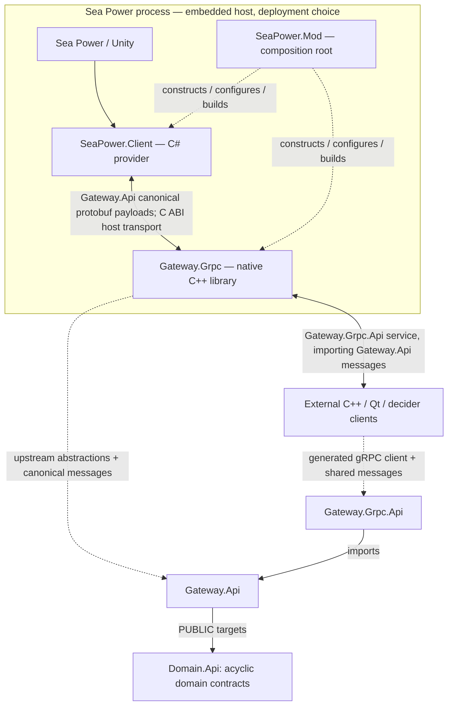

# Architecture — Naval Simulation Observation and Control

**Authority:** this file defines the stable system architecture, including long-term extension points. It is not an implementation diary. Repository and build conventions are specified in [MODULE_STRUCTURE.md](MODULE_STRUCTURE.md), developer-local sources in [LOCAL_SOURCES.md](LOCAL_SOURCES.md), and code style in [CODE_STYLE.md](CODE_STYLE.md). Runtime investigations and dated implementation evidence are preserved separately under [Tasks/](Tasks/README.md).

## 1. Purpose and scope

Build a platform that makes an externally controlled naval force accessible through stable, structured, simulator-independent APIs. First use case: let an external process, especially an LLM-driven commander, observe and command units in **Sea Power** through high-level orders while preserving useful native game automation. Other consumers include deterministic scripts, a tactical viewer, a recorder/replayer, or another compatible simulator.

Separate:

- **Backend:** authoritative source of state and execution of orders (Sea Power, mock, future backend).
- **Operational domain:** faction-visible observations and high-level orders, independent of backend implementation.
- **Privileged runtime control:** optional pause/resume/execution management; not part of the operational world.
- **Client:** generic typed access, local state cache, and incident access; no assumption about decision-making algorithm.
- **Decision runtime:** interchangeable decision policies/model providers and a separate evaluation scheduler.
- **Presentation:** independent tactical visualization and annotations.
- **Record/replay:** observations, incident records, decisions, and execution outcomes for debugging and future AI experimentation.

### Module graph and deployment

**Repositories are separate from process boundaries.** Six independent functional Git repositories form the integration spine. A seventh `Build.CMake` repository owns shared build infrastructure and is not a runtime module:

| Repository | Language | Responsibility | Direct implementation dependencies |
|---|---|---|---|
| `Domain.Api` | C++ headers | Physics, uncertainty, catalog, authoritative units, observer observations, orders, environment and world ownership boundaries | Eight-domain acyclic graph below; no gateway, wire, simulator or third-party dependency |
| `SeaPower.Client` | C# | Thin Sea Power-facing implementation: faction observations, native command dispatch and engine-thread safety | `Gateway.Api` generated C# wire messages; no parallel managed domain model and no `Gateway.Grpc` dependency |
| `Gateway.Api` | language-neutral `.proto` plus generated C# / C++ bindings and narrow C++ provider interfaces | **Canonical upstream Gateway-owned contract**: message types and provider/gateway interaction semantics | Required `Domain.Api` targets exposed PUBLIC transitively; no Sea Power, hosting mechanism or gRPC service implementation |
| `Gateway.Grpc` | C++ | Generic gateway implementation: receives provider observations/commands through `Gateway.Api`, serves external clients via `Gateway.Grpc.Api` | `Gateway.Api`, `Gateway.Grpc.Api`, domain contracts; **not** `SeaPower.Client` or `SeaPower.Mod` |
| `Gateway.Grpc.Api` | `.proto` | **External gRPC service definitions**; imports and reuses canonical messages from `Gateway.Api`, without redefining their payloads | `Gateway.Api` proto definitions |
| `SeaPower.Mod` | C# composition root with narrowly scoped C++ native host/shim build | Loader-facing mod wrapper, dependency injection, configuration, C ABI glue, gateway startup/shutdown, dependency builds and distributable packaging | Composes `SeaPower.Client` and `Gateway.Grpc`; uses API repositories; implementation-to-implementation knowledge lives **only here** |

The independently launched generic **external C++ client** consumes `Gateway.Grpc.Api` and the shared messages from `Gateway.Api`. A minimal CLI can be hosted in a separate application repo or a justified existing client module; it must not become a dependency of either gateway or Sea Power provider. `Domain.Api` physically owns eight separate truth/observation domain boundaries. Incidents remain an extension boundary. Operational domain contracts own **operational meaning**, distinct from Gateway communication interfaces.

**One canonical Protobuf message schema, two ways of exchanging messages.** `Gateway.Api` owns the sole canonical `.proto` declarations for observer-facing operational representations, orders, status, incidents, session, and any explicitly privileged internal recording contracts. Generate **C# and C++ code from the exact same proto sources**; do not create separately maintained or transformed payload schemas. `Gateway.Grpc.Api` owns external `service`/RPC definitions and transport-only envelopes and imports the canonical messages. The internal C# ↔ C++ bridge exchanges serialized protobuf messages through a bounded C ABI; **it does not run gRPC**. Ordinary provider and `GetView` paths expose ObserverSnapshot/UnitObservation only, never simulation truth or truth-to-observation correlations.

**Ownership and dependency direction:** `World.Api` / `Orders.Api` / other operational domain APIs determine semantics; `Gateway.Api` owns stable shared serialization and provider-facing communications; `Gateway.Grpc.Api` owns public RPC services. Neither `SeaPower.Client` nor `Gateway.Grpc` may unilaterally redefine `Gateway.Api`; contracts are changed deliberately, with coordinated breaking migrations permitted before release. Reuse the same common messages unless there is a documented reason a particular operation needs a transport-only envelope. Generated protobuf types are **wire/adapter types**, not substitutes for domain interfaces. Do not expose Unity/game objects or hidden authoritative enemy state through the shared schema.

**In-process deployment is not a compile-time dependency.** The default mod distribution composes the two independent implementations in `SeaPower.Mod`: its C# bootstrap/DI references the C# provider and loads a native C++ host/shim linked against the generic `Gateway.Grpc` library, while a narrow C ABI carries immutable bounded serialized messages. The gateway's implementation interfaces do **not** mention P/Invoke, C#, Sea Power or DLL hosting. An optional `Gateway.Host.Standalone` composition root supplies an IPC-facing `Gateway.Api` adapter and runs the **same unmodified `Gateway.Grpc` library** as an executable. Independent mock hosting must exercise the reusable gateway without the game or the mod; production standalone IPC is a separate extension. Worker threads must never dereference Unity/ECS game objects. Actual in-process hosting is an integration responsibility of the composition root, and must be regression-tested when the hosting, toolchain or binary interface changes.

Clients normally run as separate processes, including in the developer setup. The published mod may optionally bundle and auto-launch a **separate client executable** later, while independently launched local/remote clients remain supported. Client-launch policy, pause control and scenario startup remain deployment/runtime concerns, not operational naval data. A replay reader need not run through the live gateway.

## 2. Public API domains

The platform models the following operational domains. Their boundaries do **not** require one repository or gRPC service each.

| Domain | Responsibility | Update pattern |
|---|---|---|
| Catalog | Definitive scenario-context unit/equipment/resource definitions and resolved loadouts | Mostly static, content-versioned |
| Simulation truth | Authoritative simulated tactical entities and supported definite runtime state | Dynamic, privileged |
| Observer views | Per-observer friendly/enemy observations with field-level evidence and uncertainty | Dynamic, perspective-scoped |
| Orders | Descriptions, per-observation availability, requests and execution results | Definitions mostly static; availability and lifecycle dynamic |
| Environment | Supported terrain, depth, weather and ocean observations | Spatial/on-demand; only where safe and supported |
| Incidents | Retained, observer-legitimate short-lived occurrences affecting context | Append-only per session/observer with bounded retention |

### Simulation truth and observer observations

`Units.Api::UnitInstance` and `EquipmentInstance` represent authoritative simulated entities and capabilities. Every expressed property is definite; these types have no `Exact<T>`, observer IDs or order eligibility. Unsupported or unavailable truth is absent rather than defaulted.

`Observations.Api::UnitObservation` and `EquipmentObservation` are separate per-observer evidence structures. `Uncertainty.Api::Exact<T>` has exactly two states: Known(value) or Unknown; it has no Estimated state, confidence, source string or provenance bundle. An observed position distinguishes wholly exact position from a specialized partially localized position with source-reported coordinates and uncertainty geometry; an approximate position is never represented as `Exact<Position>`. A contact may be false, duplicated, fused or ambiguous, with no 1:1 `UnitId` mapping. Friendly and hostile observations share `ObservationId`.

Observation contributors are typed observer-side relations. A contributing observer unit is referenced by `ObservationId`, never a true `UnitId`; reported sensors use source-supported sensor/capability identifiers. Contributor and sensor lists contain only currently reported identities and are not exhaustive claims. Aggregate plotted contacts without verified attribution leave these lists empty; they do not invent sensor or owner identities.

Ordinary operational GetView, discovery, order requests and provider observations carry `ObserverSnapshot` and `UnitObservation` only. They never expose simulation `UnitId`, hidden true state or truth-to-observation association. Privileged simulation and observer snapshots are distinct root types; there is no combined View with optional truth and observation fields. The provider resolves `ObservationId` internally, then checks current observer authority and native safety before command execution.

A simulated tactical **unit is not necessarily a crewed platform or vehicle**. An independently represented missile, torpedo or other projectile can be a `UnitInstance` with its own `UnitId`, optional catalog type and supported kinematics, with no aircraft, crew, platform classification or air-operations requirement. A carried munition remains launcher equipment/resource inventory; a launched projectile is a separate entity. No projectile commandability follows from tracking or classification.

World owns separate `SimulationSnapshot` truth and perspective-specific `ObserverSnapshot` relations. `World.Api::RecordedSnapshots` retains these distinct snapshots and optional privileged zero-to-many/many-to-one truth-observation associations. `Gateway.Api`'s internal `RecordedSession` can additionally retain commands and outcomes without making them public. Ordinary snapshots and RPCs cannot expose associations or privileged recording data; recording does not imply deterministic replay.

Catalog definitions are definitive for a resolved content context. One `EquipmentType` describes an independently addressable capability, not a physical mount, and may have multiple effects and operations. **Use** invokes once; **SetActive** requests operating state. Invocation duration does not state lasting-effect duration. Guidance and emission are separate properties. An empty accepted-target list means no designation, not a required `None` argument.

One catalog resource definition describes strong identity, integer/continuous representation, measurement unit and consumable/depletable versus allocatable accounting. A shared resource value serves separate nominal-fit, operation consume/reserve and current-inventory relations. Discrete counts remain integers. True instance quantities are definite; an observed amount uses `Exact<ResourceValue>` only when wholly known, otherwise Unknown or a justified specialized partial quantity. Observer item lists are reports, not completeness claims; empty does not prove unarmed.

Navigation uses one route fact: `Exact<vector<ObservedRoutePoint>>::Known({})` is definitely empty; Unknown means uninspected/unknown. Heading and course-over-ground are distinct. Snapshot capture time is not contact measurement time. Measurement age remains Unknown unless actually available. There is no generic observed-collection coverage model; partial localization and source attribution use specialized observation types.

`Gateway.Api` encodes Exact known/absent values using protobuf presence, so zero and false remain representable. Public operational protobuf carries observer snapshots and per-observation order overlays only. Internal recording wire types are isolated from GetView, provider publication, debug switches and public RPCs. Catalog retrieval, equipment extraction, replay storage and environment acquisition remain outside this task unless actually implemented and source-supported.

### Acyclic domain ownership

All headers live under `Domain.Api/public/NavalCommand/<Domain>/Api/`, mirroring namespaces. Each populated domain has an independent header-only INTERFACE target. Environment remains a reserved boundary if no safe, verified contract exists.

| Domain | Ownership | Allowed direct dependencies |
| `Physics.Api` | Focused physical quantities and geometry | None |
| `Uncertainty.Api` | Minimal optional-backed `Exact<T>` with only Known(value)/Unknown | None |
| `Catalog.Api` | Definitive units, resource, equipment and unit-type definitions | Physics |
| `Units.Api` | Authoritative `UnitId`, `UnitInstance` and `EquipmentInstance` | Catalog, Physics |
| `Observations.Api` | Observer IDs/observations, `Exact<T>` all-or-nothing facts, specialized partial kinematics, typed contributors and measurement evidence | Catalog, Physics, Uncertainty |
| `Orders.Api` | Typed order requests/results/descriptions and per-observation availability overlay | Observations, Physics (Uncertainty is allowlisted if directly needed; current headers do not use it) |
| `Environment.Api` | Supported definitive/environment observations; reserved when unpopulated | Physics, Uncertainty |
| `World.Api` | Separate simulation/observer snapshots and respective faction/task-force relationship overlays | Units, Observations, Environment when populated, Physics, Uncertainty |

No other direct edges are allowed. The table records actual target links; an allowlisted dependency is linked only when an exported header uses it. In particular Units must not import Uncertainty, Observations, Orders or World; Observations must not import Units or World; Orders must not import Units or World; World must not import Orders. CTest checks direct public-header includes and actual direct CMake target links against the allowlist, detects cycles and reports offending files/targets. Negative fixtures reject forbidden includes/links even with a shared include root. Each exported header compiles independently through its owning target.

Keep one `Orders.Api` for deployed-unit route requests and verified AirOperations commands. Requests contain exactly one typed payload and reference an `ObservationId` scoped to the requesting observer/session. `OrderAvailability` is a separate overlay keyed by that observation and carries typed order kinds with per-order Unknown/Blocked/Unsupported/Executable state and grounded reasons. It contains a plain list of reported rows, not generic completeness coverage; a missing row never grants execution. It is not a UnitInstance/UnitObservation/World snapshot component. The provider rechecks current control, membership, freshness, native automation protection and execution preconditions adjacent to dispatch; rejection is never auto-replayed.

Sea Power contacts must be captured from selected-side plotting data through a field-level whitelist. Native contacts retain references to true objects and some engagement calculations explicitly consume `BaseObject`; this is not evidence that true target state is observer-visible. Never build observer records by serializing and redacting privileged simulation state when native sensing data is required. Measurement age and sensor contributors remain unknown/unavailable unless actually source-supported.

### Environment queries

Avoid dumping global bathymetry or large grids every evaluation. Favor bounded point/area/tile/corridor queries. Only expose values the backend can supply without perturbing simulation state. Inspected acoustic getters can seed Unity's global RNG and caches; defer unsupported or unsafe fields. Terrain sentinels are not measured depth.

## 3. Operational interface versus runtime control

The **operational API** contains domain data and operational time, not game mechanics. It can be used with a mock backend, replay, or another data source. It must not expose scores, editor-only truth, game pause states, or speed multipliers as naval-world facts.

The **runtime control API** is independent, optional and privileged. A backend that permits managed execution may expose capabilities to pause/resume, inspect execution state, or regulate progression. The scheduler uses these interfaces; decision policies generally do not. Some backends might not support runtime control at all.

Use an operational timestamp plus a session/run identifier and an observation version/cursor where appropriate. Make units and timestamp conventions explicit. Snapshots returned for one decision should be internally consistent; independent client query frequencies must not imply inconsistent time bases. A narrow managed-data sample on the engine thread can pass checked fixed-job flags while global ECS/sensor coherence remains unproven. Do not describe all observations as one atomic epoch; carry per-field/sample timestamps and stale/unknown state until validated.

## 4. Time and decision scheduling

A default slow-decision scheduler invokes the decider at a configurable interval **N seconds of operational time**. The UI/cache may update much more often. Incidents do not force an LLM invocation.

- **Synchronous:** pause execution while a scheduled decision is being made; resume after its submission/result has been handled. Do not release a user-initiated pause inadvertently.
- **Hybrid:** normally run while the slow decider thinks; if the next due evaluation occurs before the previous one completes, pause until the decider catches up, then resume. Precise missed-cycle policy is not yet frozen.
- **Fully asynchronous:** never pause for slow decisions. Bound in-flight evaluations/queues and avoid submitting obsolete commands; exact missed-cycle and staleness policy remains open.

The scheduler is separate from both the decision policy and the client transport. Decisions must carry the observation version/time on which they were based, enabling stale-request checks. Do not conflate wall time with operational time or assume all backends can pause. **Do not promise exact tick-boundary stops:** observed deadlines may be crossed between frame updates. Paused-mode commands must be dispatchable without requiring `FixedUpdate`; ownership of the global native pause is not built into the game's `GameTime` API.

## 5. Native automation and control

**Central goal: reuse Sea Power's native semi-automatic order execution and urgent response behaviors.** For example, native missile evasion may interrupt a current aircraft order; another player order may override that behavior. A slow decider must be prevented from accidentally overriding protected urgent behavior and make the affected unit's activity/availability visible to the observer.

Do not prejudge how Sea Power encodes these states. Investigation must establish actual objects, order lifecycle, autonomy triggers, interruption/resumption, and whether independent native behavior can be disabled per unit/subsystem. Future fast external deterministic controllers must remain possible; avoid committing a speculative command-ownership hierarchy without evidence. Authority and instantaneous command availability should remain distinguishable concepts. On an inspected Sea Power build, advanced aircraft missile evasion is a priority state with temporary steering/speed/altitude control; a regular UI movement path can call `Aircraft.CeaseFire()` and terminate evasion, suppressing re-entry against the same missile. It restores selected controls, not necessarily the full previous state/order. The adapter requires a dispatch-time protected-state check, including relevant formation members; never assume automatic order resumption. **Durable command authority against an active native strategic planner remains unresolved**: An observed AI-side waypoint retained control only while the strategic `AIPlayer.IsForcedToDisable` flag was true. Do not generalize this to active AI planning.

## 6. Incident history (not LLM event callbacks)

Capture observable short-lived incidents that could be missed between snapshots. The slow decision policy reads accumulated history at its normal evaluation cadence. A fast native/deterministic controller may independently react to time-critical events.

The preferred semantics are **read + acknowledge**, effectively a clearable queue **per consumer**, not a single shared destructive pop. Include sequence/cursor, operational timestamp, origin/subject, and bounded retention; report dropped-history gaps. UI, recorder, and decision host must be able to consume independently. Specific incident taxonomy comes from evidence; avoid exposing hidden enemy events. Typed state transitions (`StateMachine.OnStateChanged`) and selected-side plotting table callbacks are possible capture points, but each hook needs version-specific thread/lifecycle verification; capture only observer-eligible data and finalize records at a validated safe point.

## 7. Injectable tasks, mission text, intelligence

Sea Power is single-player-focused: player-facing mission briefings should **not** be assumed available to AI-controlled factions. The decision context supports externally provided textual briefings, tasking, intelligence and constraints, initially from user-authored files if convenient. In the future, these may come from other services or from verified backend data.

Such inputs should be **sourced and distinguishable** from sensor observations. Do not insert user intelligence into the objective track state as if it were an observed measurement. Do not require a specific LLM prompt format in general-purpose context interfaces.

## 8. Client and decision-engine separation

The C++ generic client can expose a coherent observable world cache, catalog access, incident reader, and order submission. It must be suitable for deterministic programs as well as LLM engines. The tactical UI is a separately composable read-only observer. It may overlay explicit *decision annotations* (intent, hypotheses, brief human-readable rationale), but these annotations are not verified simulation facts and must not mutate the world model.

A decision policy is modular independently of the model runtime: single LLM, LLM assisted by deterministic algorithms, hierarchical multi-LLM, or fully deterministic policies. Model connectors may use local services or remote agents, with structured-output or tool-driven interaction. No runtime, provider, or topology is privileged in the generic client.

Represent repeatable, explicit high-level orders rather than blind desired-state reconciliation. Native player behavior distinguishes replacing a route from appending waypoints; the adapter must preserve this distinction and respect protected automatic actions. The external decider should generally issue mission/waypoint/engagement-level orders, not micromanage every simulation tick.

The implemented waypoint payload has explicit replace/append modes and a default idle-waypoint mode. Explicit modes support isolated ordinary surface navigation, preserve native speed and expose copied before/after routes plus independently sampled planned routes. Append means after the whole route, including when the GUI selected an earlier task. Non-navigation graphs, special task effects, formations and protected states remain conservatively blocked. Route mutation is distinct from executing that destination; queued append displacement is attributed only after that waypoint becomes the route head. Native exceptions after invocation report unknown effect without automatic retries.

## 9. Transport and build decisions

- **`SeaPower.Client` (C#)** is an independently buildable game-facing provider library; its API dependency is `Gateway.Api` rather than a particular C++ gateway or hosting mechanism. Never make the game provider depend on `Gateway.Grpc`.
- **`Gateway.Grpc` (C++26)** is independently buildable/testable and simulator-agnostic. It depends on `Gateway.Api` provider abstractions and `Gateway.Grpc.Api` public service definitions. It knows neither the C# provider nor embedded/standalone host.
- **`SeaPower.Mod` (composition root)** owns BepInEx/Anchor Chain integration, C#/C++ binding, C ABI wrapper/shim, configuration, dependency injection, version negotiation, lifecycle and reproducible build/package orchestration. Its embedded native DLL contains/links gateway code via **composition**, not via a gateway-to-mod dependency.
- **`Gateway.Api` and `Gateway.Grpc.Api` are separate repositories**, but **not two duplicated Protobuf payload protocols**: write common `.proto` messages once in `Gateway.Api` and import them from gRPC services in `Gateway.Grpc.Api`. Generate both C# and C++ bindings from one pinned schema source; validate cross-language round trips. Domain interfaces retain source-of-truth semantics, and generated Protobuf classes remain wire models.
- **Standalone gateway mode** uses a different composition root/upstream IPC adapter while keeping `Gateway.Grpc` unmodified. The generic gateway must remain testable with an injected mock provider without the game. A production standalone IPC host is a separate composition concern.
- **Preferred deployment** is in-process gRPC DLL, served over loopback by default. A separately launched C++ CLI client connects over gRPC. Future packaged client auto-launch is optional, not a framework dependency; only explicitly configured executables may be launched, with owned-process lifecycle safeguards.
- **C++26** where toolchain support permits; central **Build.CMake / FetchContent** for internal repository dependencies and **vcpkg manifest/pinned source builds** for external packages. Root CMake files only initialize and compose. Target definitions follow src/mock/test/app/benchmark boundaries. Configure-only presets use platform-compiler-buildtype names, Ninja and o/${presetName}. Windows target/host dependencies use x64-windows-static with the matching static MSVC runtime (/MT Release, /MTd Debug). CMake/Build.CMake resolves canonical source repositories and orchestrates managed builds; ordinary SDK-style projects/MSBuild own C# codegen, NuGet and ProjectReference compilation. Generated repository-local IDE context and all build outputs follow [MANAGED_BUILD.md](MANAGED_BUILD.md). Ignored top-level Build.Local.cmake registrations provide direct/transitive local checkout substitution before declaration; Build.CMake bootstrap may use the standard FetchContent source override. No committed workspace substitutions or duplicated CMake policy. Separate builds and mocks remain mandatory; repositories stay local until explicitly authorized for publication.
- Favor pull queries and independent query cadences; optional streaming may follow. Cache static catalogs, poll changing observations as needed, and allow on-demand environment queries as verified. A narrow thread-safe internal byte/queue transport is not itself a second RPC protocol.

## 10. Recording, replay and testing

Record what the controlled side **actually observed**, including operational timestamps, catalog revisions, relevant incidents, issued orders/results, and optional decider diagnostics. Avoid leaking authoritative hidden truth into training/evaluation traces meant to approximate operational perception.

A trace reader should satisfy the same observation-facing contracts as the live client where practical. Replaying an observation trace is distinct from deterministically rerunning combat. A small mock backend should support contract tests without requiring Sea Power to run. Test wrong-side information leaks, native-automation command rejection, stale decisions, per-consumer incident consumption and synchronization behavior.

## Sea Power integration: officially supported first, no binary edits

Use officially documented Sea Power mechanisms (scenario/user content, Workshop, editor, and verified scripting/startup extension points) wherever suitable. Official support for user content does **not** demonstrate that arbitrary C# integration is officially supported. For code hooks beyond such interfaces, evaluate community-standard loaders such as [Anchor Chain](https://github.com/SeaPower-Modders/AnchorChain) / BepInEx as *unofficial* candidates, subject to explicit compatibility verification and user approval before deployment.

The Sea Power integration must never patch, overwrite, replace, or reassemble the game's original installed executables or managed assemblies. Static decompilation for investigation is permitted; original binaries must remain intact. Reversible, loader-managed in-memory hooks can be considered only after supported interfaces prove insufficient and the user approves installing the necessary third-party loader. Keep its footprint opt-in, test-only until validated, and document rollback. If binary modification would be necessary, report the limitation instead of implementing it. Follow the project safety rules in `AGENTS.md`.

## 11. Repeatable direct-to-scenario startup (development infrastructure)

**Essential for automated/Codex-assisted debugging:** a developer must be able to launch Sea Power into a chosen, reproducible combat scenario with a single command and without manually traversing the main menu, scenario chooser, or briefing UI. Prefer a verified native launch argument, startup API, or scripting mechanism. If unavailable, build a small **opt-in development-only startup helper mod** after validating the loader and lifecycle. A helper must select an explicit local test scenario/side, avoid overriding normal launches by default, expose readiness/error signals and logs, and reset cleanly on shutdown/relaunch. Do not infer that Steam/Unity accepts a mission-path argument without testing it; GUI click automation does not meet the primary requirement. Keep this feature outside the simulator-independent operational API. Keep this separate from the operational protocol and verify each development launcher against its target game version.

## Managed composition versus development tooling

`SeaPower.Mod` owns the managed composition/runtime of the Sea Power adapter and generic gateway. Its **production** managed source is grouped under `SeaPower.Mod/managed/runtime/`; its separately built **development harness** lives under `SeaPower.Mod/managed/harness/`. The native C++ host remains under `src/`, managed CMake composition under `managed/`, actual native applications under `app/` where applicable, and thin PowerShell wrappers/packaging/test entry points under `scripts/`. These are source-ownership boundaries, not new functional Git repositories or public API domains.

- **Production runtime:** a thin, maintained C# integration component that loads/configures the native bridge, composes the provider and gateway, samples observations and dispatches orders on verified permitted game threads, and transfers immutable bounded messages to and from I/O workers. Keep game-specific observation/order implementation in `SeaPower.Client`, generic gRPC networking in `Gateway.Grpc`, and canonical message definitions in `Gateway.Api`. The runtime is not an inference client and must not implement tactical policy.
- **Independent bootstrap:** approved startup/loading and activation work without the development harness. Use stable identifiers and a validated versioned runtime configuration, respecting the project's disabled-by-default and loopback-safe defaults; select the actual permitted player side, not a hard-coded test-side alias. The game thread must never wait on worker joins, disk I/O, gRPC or inference; cleanup must be idempotent and honest about unverified game-exit semantics.
- **Development harness:** optional separately packaged C# tooling for deterministic scenario startup, readiness and error receipts, diagnostics, selected development lifecycle tests and reversible launcher/loader state. It may observe/exercise the independently enabled production runtime through its normal external transport; it must never load, reflection-attach or enable the production plugin. The production runtime may not depend on it. The harness must be usable on its own with the mod disabled.
- **Experiments:** time-bounded, explicitly opt-in task fixtures that may use the stable harness but do not extend its core merely for a single probe. Keep disposable experiment source and run-specific evidence in the numbered task archive when reproducibility is needed. Promote common capabilities into the harness only with a stable design, test coverage and separate packaging.
- **Distribution boundary:** normal deployment packages contain production runtime and native gateway artifacts but no test launcher, task-labelled plugin, scenario fixture, experiment-dependent startup condition or evidence writer. A developer test distribution is separate, explicit, reversible and inactive by default.

Development infrastructure has no authority to change the operational protocol, expose privileged enemy truth, disable native protection globally, or mutate proprietary installed game binaries. The architectural lifecycle and engineering quality gates are further specified in [DEVELOPMENT.md](DEVELOPMENT.md).

## 12. Air-facility operations

Sea Power's `FlightDeck` is common to **ground airfields, carriers and helicopter-capable ships**. Public authoritative air operations are an optional `Units.Api::AirOperations` component on an applicable true unit; the observer sees a separately modeled and appropriately filtered `Observations.Api::AirOperationsObservation`. There is no public generic Facility entity or world facility collection. Aircraft inventory, reservations, pending operations and lifecycle counts belong to air operations; definitive capability/loadout descriptions belong to Catalog; launch availability belongs only to Orders and is keyed by the owner's **ObservationId**, not true UnitId. Inventory count is grouped by aircraft type/squadron, with loadout choices observed separately. Each Orders launch selector names one loadout without duplicating or partitioning that aggregate stock count. A ground airfield, carrier or helicopter-capable ship can own this capability; a projectile does not require it.

Distinguish **(a) higher-level strategic decisions, (b) independent native facility AI deciding CAP/AEW sorties, and (c) automatic flight-deck execution**. Native facility AI remained active while `AIPlayer.IsForcedToDisable=true`; disabling the strategic AI does not imply that native aviation tasking is under exclusive external ownership. External nonplayer command arbitration is therefore still open. Do not globally disable native flight-deck automation to gain control.

**Aircraft are aggregated before spawning**, by class/squadron and available inventory. A launch request reserves stock/resources, starts pending preparation and eventually spawns an ordinary native object. **As soon as that object exists as a normal friendly game unit it receives an ordinary observer `UnitObservation` and independent order discovery, even while grounded or taxiing.** Its observation-keyed availability must protect native takeoff automation. Air operations report the owning unit's lifecycle but do not introduce a deployed-aircraft control interface. RTB is a regular observation-targeted order; recovery uses native automation. Object spawning, airborne observation and recovery/turnaround are distinct facts. Snapshot capture time is not automatically inventory measurement time.

**Inventory vocabulary matters:** unreserved aggregate stock, prepared/pending reservations, native onboard physical count, spawned/launching objects, airborne units and cooldown are different concepts. Individual hosted-airframe fuel/damage/readiness state is not established by the existing native source mapping; do not invent it. Backend validation in `createLaunchTask` is incomplete; authorize and validate on dispatch. Treat any unverified aircraft readiness data as unknown rather than inferred.

The existing `Orders.Api::LaunchAircraft` request remains constrained to one validated own small-airfield/F-4E/AirToAir combination, with dynamic squadron and count one. Capability limits are backend-specific, not permanent protocol vocabulary. Requests target the airfield's observer-specific `ObservationId`; dispatch validates current control, resources and execution layout adjacent to native reservation. Native preparation and takeoff remain active; progress distinguishes pending preparation, an ordinary grounded aircraft observation and later airborne observation. Nullable onboard/reserved/cooldown counts and unreserved stock retain distinct meanings. Recovery, other platforms/loadouts and persistent airframe identities are not implemented capabilities.

