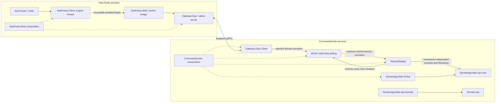

# NavalCommand architecture

The current domain headers and owner-approved revised client architecture govern V1. Earlier reports under Tasks describe historical implementations. Gameplay orders, AI scheduling, event buses and replay are outside this integration.

## Modules and dependencies

| Repository | Responsibility | Production dependencies |
|---|---|---|
| Domain.Api | Domain interfaces and values | Domain only |
| Gateway.Api | Canonical v2 protobuf, exact codecs, publication provider | Domain.Api, protobuf |
| Gateway.Grpc.Api | Connect, Acquire, Read, Apply service definitions | Gateway.Api, gRPC/protobuf |
| Gateway.Grpc | Provider-injected native server | Gateway.Api, Gateway.Grpc.Api |
| SeaPower.Client | Managed game-thread sampling and runtime controls | Gateway.Api, installed game references |
| SeaPower.Mod | Server composition, loader, byte bridge and packaging | SeaPower.Client, Gateway.Grpc, API modules |
| Gateway.Grpc.Client | Remote domain provider/controller implementations | Domain.Api, Gateway.Api, Gateway.Grpc.Api, gRPC/protobuf |
| World | Provider-injected replication and cached domain interfaces | Domain.Api |
| Symbology.Nato.Api | APP-06(E)(1) SIDC, semantic amplifiers, renderer contract and optional domain adapter | C++ standard library; Domain.Api for the separate domain adapter target |
| Symbology.Nato.ImGui | Dear ImGui implementation of the NATO renderer contract | Symbology.Nato.Api, Dear ImGui |
| TacticalDisplay | Provider-injected presentation library and geographic projection | Domain.Api, Symbology.Nato.Api, Dear ImGui, Win32/D3D11 |
| CommandCenter | Sole client composition root | Gateway.Grpc.Client, World, TacticalDisplay, Symbology.Nato.ImGui |
| Build.CMake | Shared build/dependency policy | Infrastructure only |

Test dependencies are separate. World uses local GoogleMock providers; TacticalDisplay has a local development application; client/application integration tests inject Gateway.Grpc.Mock. Test infrastructure is not a production library dependency.

World imports neither gRPC nor windowing. TacticalDisplay imports neither World nor transport, and depends only on the framework-independent NATO rendering contract; it owns geographic projection and injects no concrete renderer. Symbology.Nato.Api's core `SymbolConverter`, SIDC and semantic amplifier types work without Units or Observations. Its separate `DomainConverter` target supplies additive Unit/Observation adapters. CommandCenter constructs `Symbology.Nato.ImGui::Renderer`, injects it into TacticalDisplay, binds scopes and lifetimes, and dispatches controls. The managed/native boundary exchanges bytes, not gRPC or game objects.

NATO styling and per-symbol measurement are public Symbology.Nato.Api contracts.
The ImGui renderer measures and draws individual symbols with separate geographic
and visual anchors. TacticalDisplay owns all scene-wide collision layout, stable
hover and selection, exact-position dots and displacement connectors. Kinematic,
navigation and uncertainty geometry retain their geographic coordinates.
TacticalDisplay recovers classification/rendering failures at its presentation boundary
with the standard Unknown-dimension symbol, retains authorized amplifiers, and exposes
the conversion diagnostic in details. Strict NATO conversion still reports failures;
no new domain classification or parallel interaction pipeline is introduced.

## Domain and serialization

Domain.Api is the source of truth. Gateway.Api owns one canonical schema; Gateway.Grpc.Api imports it. C++/C# codecs preserve variant alternatives, optional presence, known false/zero, partial localization, infrastructure errors and domain errors. Unknown data is not a default value or a legitimately empty collection.

Equipment models operational capabilities. A physical launcher can yield distinct weapon/ammunition capabilities with real optional inventories. Resource-free sensors have no inventory; a present zero means a real depleted resource. Fits group resource identity/capacity/initial inventory; operations group identity/use/amount. Consumable and allocatable resources remain distinct. The owner-approved resource correction and primary platform role addition are authorized Domain.Api changes; the freeze otherwise remains in effect.

`Units::Api::Type::PrimaryPlatformRole` is an optional generic classification role
describing the platform's principal intrinsic mission. Physical `SubCategory` and
the complete `PlatformRoles` capability list remain independent dimensions. A
present primary role must also appear in that list. Absence permits a multipurpose platform or an unspecified/unrepresented mission;
consumers must not infer priority from list order or the selected loadout. The
domain-to-NATO adapter uses the primary role independently of physical subcategory
for applicable aircraft, missile and common mission modifiers. An unsupported
role/classification pair produces an explicit conversion error rather than silently
dropping the role. The Sea Power configuration ledger records deliberate absence
as well as specialist decisions, with sources and separate capability lists. Engine adapters translate native classification into these generic
values; neither the domain nor the renderer contains game-specific hull codes.
See the [decision and migration record](Tasks/023/PRIMARY_PLATFORM_ROLE_AND_ICON_CORRECTIONS.md).
The [guided missile cruiser follow-up](Tasks/023/CARRIER_FRAMES_AND_GUIDED_CRUISERS.md)
records the additional owner-approved generic role and its adapter mapping.

## Scopes and stable views

A publication contains independent omniscient and faction scopes. Omniscient units are authoritative truth. Faction scopes contain accessible authoritative units and actual native plotting-table observations. Observation identities are distinct from truth identities, scoped by observer faction, and expose no correlation map. Hidden identifiers return errors.

Connect establishes a client lifetime. Acquire pins one scope/revision; Read uses its owned opaque token. Retention is bounded and session changes invalidate tokens. The server enforces selected scopes even though trusted local clients may choose omniscient access. This is not a restricted-role authentication system.

World acquires a coherent upstream bundle, retrieves complete groups without holding publication locks, then atomically publishes an immutable retained view. Consumers explicitly rebind to refresh. Unchanged revisions reuse cached data. Perspective changes clear the current picture while binding the new scope; separate caches never merge contact identities. Communication failures preserve the last picture as stale. Mission/session invalidation clears obsolete current state. Wall-clock polling continues while simulation time is paused. GUI reads use cached domain providers exclusively.

## Engine boundary and runtime controls

Only verified engine callbacks may access game objects. Workers own gRPC, native transport, logging and byte queues. Controls cross bounded queues and are checked against session and admission deadline before engine execution. Queue acceptance is not execution success. Sampling does not wait for network/disk work.

Effective pause is the native player's claim OR any connected client's claim. Unpause releases only its owner. Disconnect releases that client's claim at the next safe engine callback, without waiting for the sampling interval. Reconnection creates fresh ownership. Unload, shutdown and adapter failure release external claims while preserving native player ownership.

Compression reports the selected resume factor. Changes while paused update native resume selection without invoking the positive compression setter, which would unpause and trigger native preparation side effects. The latest successfully applied change wins; polling never replays controls. Native inputs participate through reversible in-memory hooks. Callback safety and control behavior require real-game validation for each installed version.

## Presentation and deployment

TacticalDisplay owns Win32/D3D11/ImGui resources, map pan/zoom, selection/details, uncertainty ellipses, available operations/routes, perspective requests and runtime controls. Ellipse axes are semi-axis radii in meters. Unlocalized contacts remain selectable in details without invented map positions. Control work retains provider views and runs away from rendering; composition drains it before display destruction.

Runtime packages contain only our assemblies, protobuf runtime, native host, disabled-by-default configuration and licenses. They exclude game/loader assemblies, scenarios and harnesses. Original game binaries must remain untouched. Deployment and live activation require explicit owner authorization. Offline builds and decompiled code do not establish live safety. Current evidence and limitations are under Tasks/SeaPower-TacticalDisplay.
