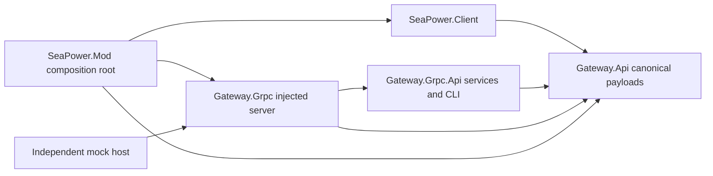

# Task 004 implementation and measured results

Date: 2026-10-09. This is a development vertical slice for Sea Power 0.8.3-261001 / Unity 6000.0.67f1. The five independently committed repositories are local repositories, not remotely published projects. Source revisions, test output, runtime receipts and final installation hashes are in [Evidence/Task004](../../Evidence/Task004). Reproduction is in [TASK004_REPRODUCTION.md](TASK004_REPRODUCTION.md).

## Ownership and build graph

| Repository | Owns | Dependencies |
|---|---|---|
| Gateway.Api | Plain C++ World.Api/Orders.Api semantics and IProvider; canonical protobuf messages, C++ wire adapter, generated C# bindings | protobuf; gtest for tests |
| Gateway.Grpc.Api | Public service importing canonical messages; independent external C++ CLI | Gateway.Api; gRPC |
| Gateway.Grpc | Generic injected-provider server and independent mock host | Gateway.Api, Gateway.Grpc.Api; gRPC, spdlog |
| SeaPower.Client | C# selected-side facade, immutable-byte provider and native validator | Gateway.Api; read-only game references |
| SeaPower.Mod | Composition, DI, native bridge implementation, managed bootstrap, configuration, source fetch/build/package and opt-in harness | All four modules |

There is no provider-to-gateway implementation reference in either direction. Mod's private native Bridge implements IProvider and its managed root injects NativeGameFacade into Provider. The exact same Gateway.Grpc Server sources link into mock-host.exe and SeaPower.Host.dll. Internal dependencies are pinned Git source fetches (CPM for C++, separate pinned managed fetch). No sibling source-directory inclusion is needed. World.Api/Orders.Api are meaningful transport-free namespaces/headers housed in Gateway.Api for this slice; no empty additional repositories were created. C# generated types are the boundary representation, not generic C++ domain types.

Gateway.Api owns session.proto, world.proto, orders.proto and incidents.proto under proto/navalcommand/gateway/v1. Gateway.Grpc.Api/service.proto imports the first three and declares five RPCs: Connect, GetView, DiscoverOrders, SubmitOrder, GetStatus. Incident is reserved and has no public consumption RPC. There are no duplicate payload definitions. C# and C++ use the same schema version 1 files; protobuf unknown fields survive direct generated-binding round trips. The domain codec does not promise preservation of unknown wire fields across a domain conversion. The schema guard checks field name/type/number and duplicate message declarations; it is not a full protobuf compatibility checker for every enum evolution.

## Native composition and threading

SeaPower.Mod/native/Host.h owns C ABI revision 1: nc_abi_version, nc_initialize, nc_publish_view, nc_publish_result, nc_poll_order, nc_shutdown. UTF-8 endpoint; caller-owned buffers; copy-in/copy-out lifetime; 1 MiB snapshot, 64 KiB order/status bounds, 64 pending commands, 128 retained IDs. Return codes: 0 success, 1 busy/no item, 2 invalid, 3 internal failure. C linkage catches exceptions. No DllMain startup, managed entry point from native threads, or runtime DLL unloading.

NativeTransport loads the absolute staged DLL with LoadLibraryExW and resolves versioned exports. The worker constructs the host, performs byte transport and writes diagnostic logs. Harmony main-thread callbacks sample at about 250 ms wall-clock intervals after the verified native job boundary; paused GameMain.Update is an additional candidate guarded by both job completion flags. No forced physics update or AI disable is introduced. Only plain queues/values cross to the worker. Snapshot coalescing is intentional; command/status overflow fails explicitly. There is no destructive public incident queue.

Mission scene unload clears provider handles, ledgers and queues and publishes unavailable state. The server remains loaded through the process lifetime and can serve a newly created session after reload. Stop is explicit on the worker and never joined inside a Unity callback. Off-game ABI shutdown/restart passes. Live tests prove scene invalidation/reload but use forced termination of their owned game process for cleanup; graceful Application.quitting completion and native shutdown receipt in the actual game are **not proven**. Native crashes can terminate Sea Power; process isolation is not provided by embedded hosting.

## Actual Sea Power access points

All references below are to the installed Seapower-Scripts.dll, SHA-256 `0FE6AAF2A6D9982E7E2EB41FD6035CB97C149773202C90821D71C00A9FDEB01A`; source and prior inspection references are in Tasks 001–003.

| Class/member | Implementation use | Evidence and limits |
|---|---|---|
| Globals.mainThread; JobPerformer.CompleteFixedUpdateJobs; ObjectCalculationsJobScheduler.HasPreviousJobCompleted; CollisionAvoidanceJobScheduler.HasPreviousJobCompleted | Main-thread assertion and completed-job sampling boundary | Live dispatch logged thread 1; fake facade rejects other threads. No general atomic-world guarantee. |
| GameMain.Update; GameTime.IsPaused(); GameTime.missionElapsedTime | Paused mailbox candidate and operational timestamps | Pause ownership remains deferred; runtime-control fields are absent from wire model. |
| Globals._playerTaskforce._taskforceUnits; ObjectBase.UnitTaskforce.Value | Selected-side own objects only, opaque per-session handles | MinimalCombat and AircraftThreat run Taskforce1. Removal/ownership checked every capture and again at dispatch. Nonplayer strategic authority remains unverified. |
| ObjectBase._geoPosition; ObjectBase._velocityInKnots | Own-unit position and SI speed conversion (1852/3600) | Own perfect state is adapter-specific. No opponent object position read for tracks. |
| PlottingTable.Vehicles; Vehicle.Id; Vehicle.DetectedPosition | Selected-side cached contact estimate, opaque track handle | Only Id >= 7001 contact entries for this build; nullable detected position. AircraftThreat positive contact and hidden submarine negative fixture. Stamp is cache-copy time, not sensor measurement time. No true velocity, hidden UID, class or sensor-source claim. ID range remains version-specific. |
| ObjectBase.StateMachine.CurrentState; AircraftStates.AdvancedMissileEvasion | Dispatch guard and dynamic eligibility | Live aircraft rejection protected_native_action. Other state-name guards are conservative, not equivalent live proofs. |
| Aircraft._isInFlight; Helicopter._isInFlight; ObjectBase._flightDeckState; Formation; HasControl/IsControllable/AcceptsOrdersFromPlayer | Grounded, formation and control exclusions | Grounded/formation eligibility is Unknown and rejected; no formation detach or takeoff override. Fake tests cover exclusions. |
| ObjectBase.SetWaypointTask(WaypointData); ObjectBase._userRoot.SelectedTask; ObjectBase._userRoot.TaskViewModels | Isolated-unit append waypoint, current height, native telegraph 2, formation maneuver false; verify created task membership | Reject active SelectedTask to avoid inherited task editing. Native AddTask selects the new task, so later eligibility may be native_task_selection_active. No CeaseFire or transform mutation. |
| ObjectBase._obp._flightDeck; FlightDeck._vehiclesOnBoard; VehicleTypeOnBoard.Squadrons; Squadron.Numbers; FlightDeck.FlightDeckTasks | Narrow own facility class/squadron unreserved counts and pending aggregate | Live FFG SH-2F Default count 1, pending 1. No individual airframe identities, health/fuel, launch readiness guarantee or ETA. Facility capability/launchability is not yet exposed. |
| MissionManager.UnloadMissionAndReload; SceneManager.sceneUnloaded | Test infrastructure requests native reload; runtime invalidates session | Live CLI rejects old session and old handle and receives new session/handle; not a public runtime-control RPC. |

## Order semantics and measured outcomes

Only set_waypoint is implemented. Validation requires current session, bounded request ID, own current handle, finite latitude/longitude within geographic ranges, target within 100 NM, and observation version at most 20 published versions old. Dispatch refreshes native membership and eligibility immediately beside SetWaypointTask. Unknown/blocked/unsupported orders are rejected and never replayed.

The network returns RequestReceived/mailbox_received, not native acceptance. Main-thread validation returns Rejected or NativeTaskCreated/native_task_membership_verified. At least 5 m displacement after creation yields MovementObserved/displacement_after_native_task_creation, with an independent operational timestamp. This does not certify reaching the waypoint or exclusive causation of movement. A 128-entry session ledger retains duplicate request results across reconnects; full ledgers reject further IDs rather than silently evict. Reset invalidates prior-session status.

Real MinimalCombat waypoint smoke from the fresh-clone package produced native task creation at operational 6.01474959077314 s and 5.019104786 m displacement at 11.8566416501999 s through the in-process gRPC DLL and separately launched CLI. Old session, fabricated entity, latitude 100 and stale observation were rejected; reconnect/duplicate returned the retained outcome with one native creation. AircraftThreat observed advanced evasion and rejected at main-thread dispatch. Reload changed both session and handles. Standalone mock uses synthetic displacement, explicitly labelled mock_displacement; it is not game execution evidence.

## Gates

| Gate | Requirement | Built files/modules | Actual test command | Evidence | Result | Known limitations |
|---|---|---|---|---|---|---|
| A | Five independent builds; embedded native DI and separate mock | All five repos; SeaPower.Host.dll; mock-host.exe | Each scripts/Build-Native.ps1 or scripts/Build.ps1; Mod Start-Live | clean-build summaries, native tests, live gateway.log | Pass for build/load/hosting; lifecycle coverage Partial | ABI stop/restart tested off-game; graceful game-process shutdown receipt unverified. |
| B | Canonical shared serialization, import, actual live gRPC snapshot | Gateway.Api, Gateway.Grpc.Api, Gateway.Grpc, Mod | Conformance write → schema-roundtrip → read; Check-Schema; CLI | conformance.log, imports tests, live CLI | Pass | Proto optional/unknown tests scoped; sample is not globally atomic. |
| C | Real waypoint, rejection, reconnect, protected state | Provider, native host and CLI | Start-Live -Smoke; -Blocked; -ReloadTest | waypoint, protected, reload directories | Pass | Single player fixture; movement not arrival; active strategic AI authority deferred. |
| D | Read-only facility plus conditional safe launch/spawn | Provider world snapshot | Same live CLI GetView | waypoint/reload CLI facility entries | Partial | No launch command, capability validation, pending/ready/spawn receipt in the new bridge. |
| E | Clean five-repo source builds, composed package, mock and live | Fresh cloned sources, versioned package | Clean build commands in reproduction; Test-Mock; Start-Live | build summaries, package manifest, installation-check.json | Pass for tested Windows development distribution | Approved loader prerequisite; no universal loader/OS support; no game exit graceful-stop claim. |

Gate D is deliberately not marked Passed. Task 003's native launch tests do not prove this new API. The remaining safe-launch work is an explicit facility validator (class/squadron/loadout/count/resource/operability), a typed order, and bridge receipts for PendingLaunchTask.Launched/new own-unit discovery. CoreService/native promises have incomplete validation; direct argument forwarding is not an acceptable implementation. This requires another bounded player-facility experiment, while retaining native takeoff automation and existing Orders.Api.

## Toolchain, failures and safety

CMake 4.2.2, clang-cl 19.1.5, MSVC runtime/linker 19.44, source-built vcpkg dependencies pinned to baseline 3ddaad9be959816602453ecb05533f8732464ef4. Actual clang flag is -std=c++2c; compile checks enforce __cplusplus >= 202400 and std::expected. MSVC alone could not configure C++26. Full C++26 library support is not claimed. LLVM lld failed linking the large static gRPC archive; Microsoft link.exe succeeds. .NET SDK 10.0.401 final build, C# netstandard2.0/2.1 integration, protoc 33.4 and Google.Protobuf 3.33.4. Internal source uses CPM 0.42.0. External dependencies were built from source with binary caches disabled.

An initial CMake re-install used VSDevCmd's overwritten VCPKG_ROOT; that redundant installer was stopped and scripts now restore the explicit root. The final build uses the sourcebuilt preset and an already completed source-built prefix (copied from this task's vcpkg package outputs). Independent clean clones reuse these external dependencies; no claim of an uncached repeated dependency build is made.

Initial live failures were resolved: a Unity component dependency-load failure was replaced with a plain main-thread runtime; Mono needed explicit off-thread loading of staged assemblies; packaged NuGet System.Memory collided with Unity's platform Span identity and caused System.Text.Json MissingMethodException during mission startup. The package now excludes those System.* DLLs and loads the game's existing platform shims read-only. Historical loader UnityLogWriter warnings still occur. No vendor assembly or Steam/platform binary was changed.

All runs opt into the approved development harness. The native package stays outside the installation. The wrapper backs up/restores only our own LaunchCandidate.dll and the prior loader configuration, closes only its owned game process and leaves normal launch inactive. Initial cleanup met a transient file lock; recovered exact original bytes and updated cleanup to wait/retry. Final evidence rehashes every vendor file from the 233-file Task 002 baseline. No proprietary binaries/decompiled sources are committed or packaged. Loopback only, config enabled false, clientAutoLaunch false. LLM, GUI, schedulers, remote authentication, general AI suppression and new launch orders remain out of scope.
