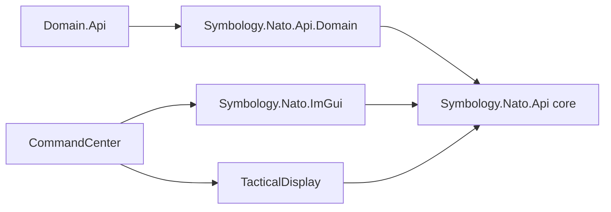

# Task 022 — APP-06(E)(1) symbology implementation

## Standard and source material

The implementation uses **NATO APP-06(E), Edition E, Version 1**, SIDC version code `14`. The 30-position SIDC layout, symbol-set assignments, operational status values, affiliation colors, and symbol paths were checked against the standard's symbol-set and amplifier material.

- [NATO APP-06(E), Edition E, Version 1 — official PDF](https://coi.nato.int/EWCOI/EW%20COI%20Shared%20Documents/WGs/NEWWG/EW%20Info%20Exchange%20Requirements%20Panel%20%28IERP%29/01_Governing%20Documents/Publications/APP-06%20NATO%20Symbology/APP-06%20EDE%20V1%20E.pdf)
- [APP-06(E)(1) PDF mirror](https://upload.wikimedia.org/wikipedia/en/c/ce/APP-06_E_1.pdf)

The current Domain.Api hierarchy is the mapping input. Domain.Api itself remains unchanged and frozen. The code supports the NavalCommand vocabulary in that hierarchy; it does not claim to render every symbol in APP-06(E).

## Components and dependency direction

`Symbology.Nato.Api` defines the typed SIDC, semantic amplifiers, renderer-neutral `Symbol`, projection/viewport values, and `IRenderer`. `SymbolConverter::Create` and `SymbolConverter::Parse` build symbols without requiring Units or Observations. `DomainConverter` lives in the separate `NavalCommand.Symbology.Nato.Api.Domain` target for optional simulation-backed conversion.

`Symbology.Nato.ImGui` implements `IRenderer` and depends on the core API plus Dear ImGui. Its public header has no ImGui types. TacticalDisplay depends on `IRenderer`, owns the map and geographic projection, and uses returned bounds for hit selection/highlighting. CommandCenter creates the concrete renderer before TacticalDisplay and keeps it alive until the display is destroyed.

The API defaults `Context` to `Simulation`. TacticalDisplay exposes a context dropdown for Reality, Exercise, and Simulation; the current choice is applied to converted symbols. The renderer uses the selected Exercise or Simulation context marker where defined.

## SIDC model

`Sidc` serializes and parses the standard 30-position representation. The typed core stores context, standard identity, symbol set, status, headquarters/task-force/dummy indicator, amplifier, entity, entity type, entity subtype, modifiers 1 and 2, and all ten third-ten positions. Parsing requires version `14`, uppercase hexadecimal extension characters, assigned top-level enum values, valid hierarchy fields, and zero values in the reserved third-ten positions 23–27. All ten extension characters are retained on round-trip. No 20-character helper silently drops them.

The core accepts every APP-06(E)(1) symbol set identifier. The ImGui implementation draws the generic and entity codes listed below plus generic fallbacks for supported sets. A valid SIDC outside this renderer's implemented vocabulary returns `WasDrawn=false`; it is not changed into another icon.

## Domain mapping

Codes below are `symbol set / entity / entity type / entity subtype`, with modifier 1 shown where used. Decimal field values are the APP-06(E)(1) assignments.

### Dimensions

| Domain dimension | APP-06 symbol set | Decision |
|---|---:|---|
| Air | 01 Air | Generic air symbol |
| Land | 10 Land Unit | APP-06 has no separate generic land-dimension set; use the generic land-unit symbol |
| SeaSurface | 30 Sea Surface | Generic surface symbol |
| SeaSubsurface | 35 Sea Subsurface | Generic subsurface symbol |
| Space | 05 Space | Generic space symbol |
| Other | Unsupported | No safe dimension mapping |

### Categories

| Domain category | APP-06 symbol set and entity | Decision |
|---|---|---|
| Aircraft | 01, entity 00 | Generic air symbol |
| Missile | 02, entity 11 | Generic air-missile symbol |
| SurfaceVessel | 30, entity 00 | Generic surface symbol |
| Submarine | 35, entity 11/type 01 | Generic submarine; no mission modifier is inferred |
| Torpedo | 35, entity 13/type 01 | Generic torpedo |
| Mine | 36, entity 11 | General sea mine |
| LandEquipment | 15, entity 00 | Generic land-equipment symbol |
| LandInstallation | 20, entity 00 | Generic installation symbol |
| LandUnit | 10, entity 00 | Generic land-unit symbol |
| SpaceObject | 05, entity 00 | Generic space symbol |
| SurfaceDevice | 30, entity 00 | Generic surface symbol |
| SubsurfaceDevice | 35, entity 00 | Generic subsurface symbol |
| SeaAnimal | 35, entity 00 | Generic subsurface symbol, labeled “Sea animal” |
| Other | Unsupported | No safe category mapping |

### Subcategories

| Domain subcategory | APP-06(E)(1) mapping | Standard graphic / fallback decision |
|---|---|---|
| FixedWingAircraft | 01/11/01/00 | Fixed-wing aircraft |
| RotaryWingAircraft | 01/11/02/00 | Rotary-wing aircraft |
| TiltRotorAircraft | 01/00/00/00 | Generic air symbol, labeled Tilt-rotor aircraft; no verified dedicated assignment used |
| CruiseMissile | 02/11/00/00, M1=07 | Missile with the cruise modifier |
| BallisticMissile | 02/11/00/00, M1=06 | Missile with the ballistic modifier |
| Missile | 02/11/00/00 | Generic missile |
| AircraftCarrier | 30/12/01/00 | Aircraft carrier |
| Cruiser | 30/12/02/00 | Generic surface-combatant assignment; label says “Surface combatant” rather than claiming an unsupported cruiser subtype |
| Destroyer | 30/12/02/03 | Destroyer (`DD`) |
| Frigate | 30/12/02/04 | Frigate (`FF`) |
| Corvette | 30/12/02/05 | Corvette (`FS`) |
| PatrolVessel | 30/12/05/00 | Patrol vessel |
| AmphibiousVessel | 30/12/03/00 | Amphibious warfare ship |
| AuxiliaryVessel | 30/13/01/00 | Auxiliary ship (`AA`) |
| MerchantVessel | 30/14/01/00 | General merchant ship |
| AttackSubmarine | 35/11/01/00, M1=08 | Generic submarine with attack modifier (`A`) |
| BallisticMissileSubmarine | 35/11/01/00, M1=09 | Generic submarine with ballistic-missile modifier (`B`) |
| CruiseMissileSubmarine | 35/11/01/00, M1=10 | Generic submarine with guided-missile modifier (`G`) |
| Submarine | 35/11/01/00 | Generic submarine; a generic classification never gets a mission modifier |
| HeavyweightTorpedo, LightweightTorpedo, Torpedo | 35/13/01/00 | Generic torpedo; Domain weight distinctions are not encoded as an unverified APP-06 modifier |
| NavalMine | 36/11/00/00 | General sea mine |
| Noisemaker, SelfPropelledAcousticDecoy | 35/13/03/00 | Underwater-decoy symbol; the Domain model does not provide a more specific APP-06 entity distinction |
| Sonobuoy | 30/00/00/00 | Generic surface symbol labeled Sonobuoy; no unsupported specialized code is invented |
| GroundVehicle | 15/00/00/00 | Generic equipment symbol; the APP-06 armored-personnel-vehicle assignment is not used as a generic vehicle |
| SurfaceToAirMissileLauncher | 15/11/11/00 | Surface-to-air missile launcher |
| AntiAircraftGun | 15/11/05/00 | Air-defence gun |
| Radar | 15/00/00/00 | Generic equipment symbol; no unverified radar assignment is used |
| Airfield | 20/00/00/00 | Generic installation labeled Airfield; no unverified airfield assignment is used |
| MilitaryInstallation | 20/11/00/00 | Military installation (`MIL`) |
| CivilianInstallation | 20/00/00/00 | Generic installation labeled Civilian installation |
| SurfaceVessel | 30/00/00/00 | Generic surface symbol |
| Whale | 35/00/00/00 | Generic subsurface symbol labeled Sea animal |
| Other | Unsupported | Explicit conversion error, not a made-up identity |

An exact observation `TypeId` is resolved only through a caller-provided matching authorized `Units.Api::Type`. Missing exact definitions remain generic. Unit type definitions with a mismatched TypeId are rejected. Observation conversion uses only the observation's own classification and caller-resolved affiliation; it does not correlate the observation to an authoritative unit. Platform and loadout roles are not translated into modifiers: the available role vocabulary has no single approved, conflict-free precedence mapping, and inactive loadouts must not influence a current symbol.

## Affiliation and destruction

The API accepts APP-06 identities Pending, Unknown, Assumed Friendly, Friendly, Neutral, Suspect, and Hostile. `DomainConverter::FromAlignment` maps only Domain's actual Friendly, Neutral, and Hostile values. The caller supplies resolved identity; it is not inferred from nationality, name, or type. TacticalDisplay supplies observation alignment relative to its observer perspective.

Affiliation colors are Unknown yellow `(255,255,0)`, Friendly/Assumed Friendly cyan `(0,255,255)`, Neutral green `(0,255,0)`, and Hostile/Suspect red `(255,0,0)`. Pending, Assumed Friendly, and Suspect identities use the uncertain-identity patterned outline. Status 1 uses the planned/anticipated dashed outline.

Unit `IsDestroyed=true` and known-true observation destruction use SIDC status 4 (Present Destroyed). Known false uses status 0 (Present). Unknown observation destruction remains `Symbol::IsDestroyed == nullopt`; it is not rewritten to `false`. The optional fact is retained separately because APP status codes have no unknown-destruction value. A caller who supplies explicit `IsDestroyed` metadata that conflicts with a SIDC status is rejected by `SymbolConverter`.

Statuses 2–5 use an operational-condition bar: fully capable green, damaged yellow, destroyed red, and full-to-capacity blue `(0,180,240)`, outlined in the symbol's affiliation color. Status 4 is therefore distinguishable both through the SIDC and the bar.

## Semantic amplifiers and projection

`Amplifiers` stores semantic data only—no pixel offsets, font settings, or ImGui values:

- Unique designation, name/type, and additional information text.
- Heading, course-over-ground, and speed as optional radians / metres per second.
- A typed vertical value in metres with an explicit Altitude, Depth, or Elevation reference.
- Optional geographic latitude and longitude, each independently optional.
- Optional uncertainty ellipse with semi-axis radii in metres and north-referenced orientation in radians.

Heading is displayed as a separate text value and never drives movement graphics. A speed leader requires both course and speed, uses the configured time horizon, and asks TacticalDisplay's projection to convert east/north physical offsets into screen-space. The renderer does not assume a fixed pixel-to-metre ratio or rotate geographic north a second time. The map projection owns orientation. Unknown speed/course produces no corresponding movement amplifier. Altitude labels apply to air/space sets; depth labels apply to the subsurface set; other vertical positions are labeled Elevation. Incomplete geographic positions remain partial and are not projected as an invented point. The uncertainty ellipse is a display extension using the existing Domain uncertainty model, not a claim that APP-06 encodes an uncertainty area in the SIDC.

## Renderer responsibilities and limits

The renderer implements affiliation frames for the supported dimensions, standard affiliation colors, supported internal entity paths/marks, headquarters/task-force/dummy indicators, context marks, operational-condition bars, text amplifiers, movement arrows/leaders, and projected uncertainty ellipses. It returns screen bounds for selection independently of icon geometry. Text and graphical marks are clipped to the supplied viewport.

Supported internal marks include fixed- and rotary-wing aircraft, generic missiles and B/C missile modifiers, carriers, combatants, destroyers/frigates/corvettes, amphibious and patrol vessels, auxiliary and merchant ships, generic and mission-modified submarines, torpedoes, underwater decoys, sea mines, air-defence guns, surface-to-air launchers, and military installations. All current Domain subcategories either use one of these exact assignments or the documented generic fallback above. Other valid APP-06 symbol codes are not drawn yet.

TacticalDisplay still chooses visibility and optional amplifier data, owns navigation and geographic projection, handles selection/details, and exposes the Simulation-default context dropdown. Close symbols retain per-symbol renderer bounds and the existing interaction; no map-wide clustering or persistent decluttering policy was added.

## Validation

Windows/MSVC/Ninja Debug builds use the repository's `windows-msvc-debug` presets and `x64-windows-static` vcpkg triplet. Tests cover the 30-character example and round-trip, all declared symbol sets, field validation, Domain dimensions/categories/subcategories, authorized TypeId resolution, role non-mapping, destruction certainty, partial positions, affiliations, exact supported renderer assignments and modifiers, scale/bounds, movement, heading/course, vertical applicability, and projected uncertainty.

| Validation | Result |
|---|---|
| Symbology.Nato.Api Debug build and CTest | Passed — 23/23 tests |
| Symbology.Nato.ImGui Debug build and CTest | Passed — 8/8 tests |
| TacticalDisplay Debug build and CTest | Passed — 1/1 test |
| CommandCenter Debug build and CTest | Passed — 2/2 tests |

The renderer tests use deterministic draw-command inspection, including a real Dear ImGui context; no live Sea Power runtime is required or started.

## Feature branch commits

All implementation remains on `feature/classification`; no branch is merged into `main`.

| Repository | Commit | Remote |
|---|---|---|
| Symbology.Nato.Api | [`f4559146c3f1e4c35aea5d08f41d76dcac113172`](https://github.com/NavalCommand/Symbology.Nato.Api/commit/f4559146c3f1e4c35aea5d08f41d76dcac113172) | [feature/classification](https://github.com/NavalCommand/Symbology.Nato.Api/tree/feature/classification) |
| Symbology.Nato.ImGui | [`0c76bbfb7e99dae5d655adb6caac12ef4402fb89`](https://github.com/NavalCommand/Symbology.Nato.ImGui/commit/0c76bbfb7e99dae5d655adb6caac12ef4402fb89) | [feature/classification](https://github.com/NavalCommand/Symbology.Nato.ImGui/tree/feature/classification) |
| TacticalDisplay | [`747af514a438e119b9a454313d36df35cf83f1b4`](https://github.com/NavalCommand/TacticalDisplay/commit/747af514a438e119b9a454313d36df35cf83f1b4) | [feature/classification](https://github.com/NavalCommand/TacticalDisplay/tree/feature/classification) |
| CommandCenter | [`37b4a49024556c581e1e7a808427aaffae441fa2`](https://github.com/NavalCommand/CommandCenter/commit/37b4a49024556c581e1e7a808427aaffae441fa2) | [feature/classification](https://github.com/NavalCommand/CommandCenter/tree/feature/classification) |
| Docs | This implementation report commit | [feature/classification](https://github.com/NavalCommand/Docs/tree/feature/classification) |
