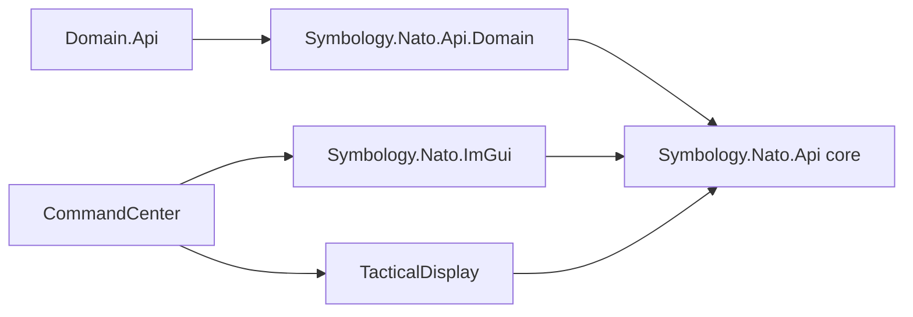

# Task 022 — APP-06(E)(1) symbology implementation

## Standard and source material

The implementation uses **NATO APP-06(E), Edition E, Version 1**, SIDC version code `14`. The 30-position SIDC layout, symbol-set assignments, operational status values, affiliation colors, and symbol paths were checked against the standard's symbol-set and amplifier material.

- [NATO APP-06(E), Edition E, Version 1 — official PDF](https://coi.nato.int/EWCOI/EW%20COI%20Shared%20Documents/WGs/NEWWG/EW%20Info%20Exchange%20Requirements%20Panel%20%28IERP%29/01_Governing%20Documents/Publications/APP-06%20NATO%20Symbology/APP-06%20EDE%20V1%20E.pdf)
- [APP-06(E)(1) PDF mirror](https://upload.wikimedia.org/wikipedia/en/c/ce/APP-06_E_1.pdf)

The current Domain.Api hierarchy is the mapping input. Domain.Api itself remains unchanged and frozen. The code supports the NavalCommand vocabulary in that hierarchy; it does not claim to render every symbol in APP-06(E).

## Components and dependency direction

`Symbology.Nato.Api` defines the typed SIDC, semantic amplifiers, renderer-neutral `Symbol`, projection/viewport values, and `IRenderer`. `SymbolConverter::Create` and `SymbolConverter::Parse` build symbols without requiring Units or Observations. `DomainConverter` lives in the separate `NavalCommand.Symbology.Nato.Api.Domain` target for optional simulation-backed conversion.

`Symbology.Nato.ImGui` implements `IRenderer` and depends on the core API plus Dear ImGui. Its public header has no ImGui types. TacticalDisplay depends on `IRenderer`, owns the map and geographic projection, and uses returned bounds for hit selection/highlighting. CommandCenter creates the concrete renderer before TacticalDisplay and keeps it alive until the display is destroyed.

The API defaults `Context` to `Reality`. TacticalDisplay exposes a context dropdown for Reality, Exercise, and Simulation; the current choice is applied to converted symbols. The renderer uses the selected Exercise or Simulation context marker where defined.

## SIDC model

`Sidc` serializes and parses the standard 30-position representation. The typed core stores context, standard identity, symbol set, status, headquarters/task-force/dummy indicator, amplifier, entity, entity type, entity subtype, modifiers 1 and 2, and all ten third-ten positions. Parsing requires version `14`, uppercase hexadecimal extension characters, assigned top-level enum values, valid hierarchy fields, and zero values in the reserved third-ten positions 23–27. All ten extension characters are retained on round-trip. No 20-character helper silently drops them.

The core accepts every APP-06(E)(1) symbol set identifier. The ImGui implementation draws the generic and entity codes listed below plus generic fallbacks for supported sets. A valid SIDC outside this renderer's implemented vocabulary returns `WasDrawn=false`; it is not changed into another icon.

## Domain mapping

Codes below are `symbol set / entity / entity type / entity subtype`, with modifier 1 shown where used. Decimal field values are the APP-06(E)(1) assignments.

### Dimensions

| Domain dimension | APP-06 symbol set | Decision |
|---|---:|---|
| Air | 01 Air | Generic air symbol |
| Land | 10 Land Unit | APP-06 has no separate generic land-dimension set; use the generic land-unit symbol |
| SeaSurface | 30 Sea Surface | Generic surface symbol |
| SeaSubsurface | 35 Sea Subsurface | Generic subsurface symbol |
| Space | 05 Space | Generic space symbol |
| Other | Unsupported | No safe dimension mapping |

### Categories

| Domain category | APP-06 symbol set and entity | Decision |
|---|---|---|
| Aircraft | 01, entity 00 | Generic air symbol |
| Missile | 02, entity 11 | Generic air-missile symbol |
| SurfaceVessel | 30, entity 00 | Generic surface symbol |
| Submarine | 35, entity 11/type 01 | Generic submarine; no mission modifier is inferred |
| Torpedo | 35, entity 13/type 01 | Generic torpedo |
| Mine | 36, entity 11 | General sea mine |
| LandEquipment | 15, entity 00 | Generic land-equipment symbol |
| LandInstallation | 20, entity 00 | Generic installation symbol |
| LandUnit | 10, entity 00 | Generic land-unit symbol |
| SpaceObject | 05, entity 00 | Generic space symbol |
| SurfaceDevice | 30, entity 00 | Generic surface symbol |
| SubsurfaceDevice | 35, entity 00 | Generic subsurface symbol |
| SeaAnimal | 35, entity 00 | Generic subsurface symbol, labeled “Sea animal” |
| Other | Unsupported | No safe category mapping |

### Subcategories

| Domain subcategory | APP-06(E)(1) mapping | Standard graphic / fallback decision |
|---|---|---|
| FixedWingAircraft | 01/11/01/00 | Fixed-wing aircraft |
| RotaryWingAircraft | 01/11/02/00 | Rotary-wing aircraft |
| TiltRotorAircraft | 01/00/00/00 | Generic air symbol, labeled Tilt-rotor aircraft; no verified dedicated assignment used |
| CruiseMissile | 02/11/00/00, M1=07 | Missile with the cruise modifier |
| BallisticMissile | 02/11/00/00, M1=06 | Missile with the ballistic modifier |
| Missile | 02/11/00/00 | Generic missile |
| AircraftCarrier | 30/12/01/00 | Aircraft carrier |
| Cruiser | 30/12/02/00 | Generic surface-combatant assignment; label says “Surface combatant” rather than claiming an unsupported cruiser subtype |
| Destroyer | 30/12/02/03 | Destroyer (`DD`) |
| Frigate | 30/12/02/04 | Frigate (`FF`) |
| Corvette | 30/12/02/05 | Corvette (`FS`) |
| PatrolVessel | 30/12/05/00 | Patrol vessel |
| AmphibiousVessel | 30/12/03/00 | Amphibious warfare ship |
| AuxiliaryVessel | 30/13/01/00 | Auxiliary ship (`AA`) |
| MerchantVessel | 30/14/01/00 | General merchant ship |
| AttackSubmarine | 35/11/01/00, M1=08 | Generic submarine with attack modifier (`A`) |
| BallisticMissileSubmarine | 35/11/01/00, M1=09 | Generic submarine with ballistic-missile modifier (`B`) |
| CruiseMissileSubmarine | 35/11/01/00, M1=10 | Generic submarine with guided-missile modifier (`G`) |
| Submarine | 35/11/01/00 | Generic submarine; a generic classification never gets a mission modifier |
| HeavyweightTorpedo, LightweightTorpedo, Torpedo | 35/13/01/00 | Generic torpedo; Domain weight distinctions are not encoded as an unverified APP-06 modifier |
| NavalMine | 36/11/00/00 | General sea mine |
| Noisemaker, SelfPropelledAcousticDecoy | 35/13/03/00 | Underwater-decoy symbol; the Domain model does not provide a more specific APP-06 entity distinction |
| Sonobuoy | 30/00/00/00 | Generic surface symbol labeled Sonobuoy; no unsupported specialized code is invented |
| GroundVehicle | 15/00/00/00 | Generic equipment symbol; the APP-06 armored-personnel-vehicle assignment is not used as a generic vehicle |
| SurfaceToAirMissileLauncher | 15/11/11/00 | Surface-to-air missile launcher |
| AntiAircraftGun | 15/11/05/00 | Air-defence gun |
| Radar | 15/00/00/00 | Generic equipment symbol; no unverified radar assignment is used |
| Airfield | 20/00/00/00 | Generic installation labeled Airfield; no unverified airfield assignment is used |
| MilitaryInstallation | 20/11/00/00 | Military installation (`MIL`) |
| CivilianInstallation | 20/00/00/00 | Generic installation labeled Civilian installation |
| SurfaceVessel | 30/00/00/00 | Generic surface symbol |
| Whale | 35/00/00/00 | Generic subsurface symbol labeled Sea animal |
| Other | Unsupported | Explicit conversion error, not a made-up identity |

An exact observation `TypeId` is resolved only through a caller-provided matching authorized `Units.Api::Type`. Missing exact definitions remain generic. Unit type definitions with a mismatched TypeId are rejected. Observation conversion uses only the observation's own classification and caller-resolved affiliation; it does not correlate the observation to an authoritative unit. Platform and loadout roles are not translated into modifiers: the available role vocabulary has no single approved, conflict-free precedence mapping, and inactive loadouts must not influence a current symbol.

## Affiliation and destruction

The API accepts APP-06 identities Pending, Unknown, Assumed Friendly, Friendly, Neutral, Suspect, and Hostile. `DomainConverter::FromAlignment` maps only Domain's actual Friendly, Neutral, and Hostile values. The caller supplies resolved identity; it is not inferred from nationality, name, or type. TacticalDisplay supplies observation alignment relative to its observer perspective.

Affiliation colors are Unknown yellow `(255,255,0)`, Friendly/Assumed Friendly cyan `(0,255,255)`, Neutral green `(0,255,0)`, and Hostile/Suspect red `(255,0,0)`. Pending, Assumed Friendly, and Suspect identities use the uncertain-identity patterned outline. Status 1 uses the planned/anticipated dashed outline.

Unit `IsDestroyed=true` and known-true observation destruction use SIDC status 4 (Present Destroyed). Known false uses status 0 (Present). Unknown observation destruction remains `Symbol::IsDestroyed == nullopt`; it is not rewritten to `false`. The optional fact is retained separately because APP status codes have no unknown-destruction value. A caller who supplies explicit `IsDestroyed` metadata that conflicts with a SIDC status is rejected by `SymbolConverter`.

Statuses 2–5 use an operational-condition bar: fully capable green, damaged yellow, destroyed red, and full-to-capacity blue `(0,180,240)`, outlined in the symbol's affiliation color. Status 4 is therefore distinguishable both through the SIDC and the bar.

## Semantic amplifiers and projection

`Amplifiers` stores semantic data only—no pixel offsets, font settings, or ImGui values:

- Unique designation, name/type, and additional information text.
- Heading, course-over-ground, and speed as optional radians / metres per second.
- A typed vertical value in metres with an explicit Altitude, Depth, or Elevation reference.
- Optional geographic latitude and longitude, each independently optional.
- Optional uncertainty ellipse with semi-axis radii in metres and north-referenced orientation in radians.

Heading is displayed as a separate text value and never drives movement graphics. A speed leader requires both course and speed, uses the configured time horizon, and asks TacticalDisplay's projection to convert east/north physical offsets into screen-space. The renderer does not assume a fixed pixel-to-metre ratio or rotate geographic north a second time. The map projection owns orientation. Unknown speed/course produces no corresponding movement amplifier. Altitude labels apply to air/space sets; depth labels apply to the subsurface set; other vertical positions are labeled Elevation. Incomplete geographic positions remain partial and are not projected as an invented point. The uncertainty ellipse is a display extension using the existing Domain uncertainty model, not a claim that APP-06 encodes an uncertainty area in the SIDC.

## Renderer responsibilities and limits

The renderer implements affiliation frames for the supported dimensions, standard affiliation colors, supported internal entity paths/marks, headquarters/task-force/dummy indicators, context marks, operational-condition bars, text amplifiers, movement arrows/leaders, and projected uncertainty ellipses. It returns screen bounds for selection independently of icon geometry. Text and graphical marks are clipped to the supplied viewport.

Supported internal marks include fixed- and rotary-wing aircraft, generic missiles and B/C missile modifiers, carriers, combatants, destroyers/frigates/corvettes, amphibious and patrol vessels, auxiliary and merchant ships, generic and mission-modified submarines, torpedoes, underwater decoys, sea mines, air-defence guns, surface-to-air launchers, and military installations. All current Domain subcategories either use one of these exact assignments or the documented generic fallback above. Other valid APP-06 symbol codes are not drawn yet.

TacticalDisplay still chooses visibility and optional amplifier data, owns navigation and geographic projection, handles selection/details, and exposes the Reality-default context dropdown. Close symbols retain per-symbol renderer bounds and the existing interaction; no map-wide clustering or persistent decluttering policy was added.

## Validation

Windows/MSVC/Ninja Debug builds use the repository's `windows-msvc-debug` presets and `x64-windows-static` vcpkg triplet. Tests cover the 30-character example and round-trip, all declared symbol sets, field validation, Domain dimensions/categories/subcategories, authorized TypeId resolution, role non-mapping, destruction certainty, partial positions, affiliations, exact supported renderer assignments and modifiers, scale/bounds, movement, heading/course, vertical applicability, and projected uncertainty.

| Validation | Result |
|---|---|
| Symbology.Nato.Api Debug build and CTest | Passed — 23/23 tests |
| Symbology.Nato.ImGui Debug build and CTest | Passed — 8/8 tests |
| TacticalDisplay Debug build and CTest | Passed — 1/1 test |
| CommandCenter Debug build and CTest | Passed — 2/2 tests |

The renderer tests use deterministic draw-command inspection, including a real Dear ImGui context; no live Sea Power runtime is required or started.

## Feature branch commits

All implementation remains on `feature/classification`; no branch is merged into `main`.

| Repository | Commit | Remote |
|---|---|---|
| Symbology.Nato.Api | [`f4559146c3f1e4c35aea5d08f41d76dcac113172`](https://github.com/NavalCommand/Symbology.Nato.Api/commit/f4559146c3f1e4c35aea5d08f41d76dcac113172) | [feature/classification](https://github.com/NavalCommand/Symbology.Nato.Api/tree/feature/classification) |
| Symbology.Nato.ImGui | [`0c76bbfb7e99dae5d655adb6caac12ef4402fb89`](https://github.com/NavalCommand/Symbology.Nato.ImGui/commit/0c76bbfb7e99dae5d655adb6caac12ef4402fb89) | [feature/classification](https://github.com/NavalCommand/Symbology.Nato.ImGui/tree/feature/classification) |
| TacticalDisplay | [`747af514a438e119b9a454313d36df35cf83f1b4`](https://github.com/NavalCommand/TacticalDisplay/commit/747af514a438e119b9a454313d36df35cf83f1b4) | [feature/classification](https://github.com/NavalCommand/TacticalDisplay/tree/feature/classification) |
| CommandCenter | [`37b4a49024556c581e1e7a808427aaffae441fa2`](https://github.com/NavalCommand/CommandCenter/commit/37b4a49024556c581e1e7a808427aaffae441fa2) | [feature/classification](https://github.com/NavalCommand/CommandCenter/tree/feature/classification) |
| Docs | This implementation report commit | [feature/classification](https://github.com/NavalCommand/Docs/tree/feature/classification) |

## Rendering follow-up, 2026-10-15

- Follow-up: enlarged carrier/cruiser path geometry to 2.8 times the original coordinate scale and submarine paths to 1.8, keeping frames and text sizes unchanged. MajorCombat force centers now use east offsets −175/+175 nm (350 nm apart); submarine offsets are −170/+170 nm.
- Radar-only identified missile correction: inspected `Vehicle.TransferFromComponents` sets the plotting-table class for weapons independently of `ClassInformation.overrideIdentification`. The adapter previously required that flag and empty candidate bits for ammunition-class resolution. It now resolves an identified, reported ammunition class before processing ordinary platform candidate bits, retaining the false-contact guard and avoiding hidden-object class reads. This restores the missile subcategory/dimension and speed-leader eligibility. Displayed motion also falls back to the already authorized native velocity when the track velocity is zero. CommandCenter, runtime and harness packages built successfully; no tests or live game verification were run for this correction.

- Torpedo geometry now has a longer hull and thicker body/tail. Internal text centering uses visible glyph extents from ImGui's font baked at the rendering size, correcting the FF side-bearing offset. TacticalDisplay loads Windows Segoe UI with Cyrillic glyph coverage. Default alternative-name configuration now selects `alternative-display-names.en.ini`. CommandCenter, runtime and harness packages built successfully; live appearance is unverified.
- Added reusable development scenario `MajorCombat`: US Nimitz/Ticonderoga/Los Angeles against Soviet Kiev/Udaloy/Kilo, with the carriers at relative east offsets −50/+50 nm and escorts/submarines nearby. Los Angeles is selected from the installed US attack-submarine catalogue; no unavailable Seawolf type is invented. Nimitz custom air wing: 24 F-14A, 24 A-7E, 12 A-6E, 4 EA-6B, 4 E-2C, 10 S-3A and 6 SH-3H (84 total, below native capacity 85). Kiev and escorts retain their native aircraft inventories. Native `FlightDeck.LoadAirgroupFromIni` confirms the squadron/count/crew syntax and pipe-delimited multiple squadrons. Scenario is packaged with the harness and discovered by the existing mission menu. No live mission was launched.

- Internal path geometry is enlarged by 25% without enlarging affiliation frames or text. Fully identified observation details display the resolved type's platform roles. Fixed-wing types with intrinsic Air Superiority receive fighter modifier 04 and an F mark. Launched missile definitions with native `AmmunitionParameters._airLaunched` and `_targetType == AAW` receive the Air Superiority role; that missile-role mapping produces air-origin modifier 01 and air-destination modifier 01, rendered as two A marks. This mapping uses intrinsic catalogue roles, not the selected loadout or a hidden observation launch platform. Native flags and the AIM-7M/AA-11 General sections were inspected read-only in the installed game. Modifier-code reference: Spatial Illusions' published Air sector 1 and Air missile sector 1/2 tables in `spatialillusions/mil-std-2525`. CommandCenter and runtime package builds succeeded; no tests or live rendering verification were run for this correction.

- Display controls now include shared symbol/text scale, Only Selected / Only Hovered / Selected and Hovered / Always labels, Type only / all labels, and a speed-leader time horizon in seconds. Zero seconds hides speed leaders. Planned navigation is gray; uncertainty is orange.
- Render results distinguish complete drawing bounds from frame/icon bounds. Selection and mouse hit detection use frame/icon bounds. Context markers sit outside the frame, and frame axes share a common scale except organization rectangles.
- Native unit names come from `ObjectBase.Name.Value`, rather than Unity's internal `name`. Type labels prefer catalogue display names.
- Read-only inspection used ILSpy 11.1 against installed `Seapower-Scripts.dll`, SHA-256 `0FE6AAF2A6D9982E7E2EB41FD6035CB97C149773202C90821D71C00A9FDEB01A`. Verified: `UnitMetadataProvider.UnitData` and `UnitIdMap` are instance properties; `ClassInformation.ForceID` sets a candidate bit; `ObjectsManager.AddObjectToItsTaskforce` excludes sonobuoys and noisemakers from the weapon-only collection. The provider now reads those catalogue properties and includes active weapon objects from the complete native object collection, scoped by owning faction.
- Verified: `Utils.unityHeightToMeter` converts native world height; `ObjectBase.getHeightInMeters` also accounts for submarine centre-to-keel offset. Authoritative and displayed contact elevation use that native getter.
- Owner explicitly approved mirroring Sea Power's player-visible heading, speed and elevation even before faction/type identification. These three fields use the same native kinematics independently of classification; observer latitude/longitude still come from the plotting-table estimate. `Vehicle.UnityVelocityVector`, inspected in `Vehicle.UpdateFromECS`, supplies the displayed course for movement graphics. This is a deliberate presentation policy exception to sensor-only kinematics, not authorization to expose true contact positions or correlate observation IDs with unit IDs.
- Exact track classification resolves observer candidate bits through the public type catalogue, including the forced-identification singleton. It does not read the hidden object's class. Weapon instances use ammunition metadata for their authoritative type and empty loadout. Identified weapon observations without catalogue candidate bits resolve the plotting table's reported class key against ammunition metadata; no object pointer is used for that lookup.
- Decompilation output stays in temporary local inspection files outside maintained source. No instrumentation or additional runtime dependencies were introduced.
- Build validation and staged-package checks are reported in the chat. Live rendering, mouse interaction and newly launched weapon visibility require a subsequent game session; no live game was launched for this follow-up.
- Phantom AN/SLQ-25 correction: on the same inspected assembly, `DecoySystem.createTowedNoisemaker` creates an attached noisemaker during ship initialization, marks it launched via `spawnWithoutLaunch`, and registers it with its faction even while `TowedSystem` initializes it stowed. `Vehicle.IsVisible` explicitly hides all towed noisemakers. Authoritative unit enumeration now excludes `Noisemaker._isTowedDecoy` from both faction and complete-object collections; expendable noisemakers remain eligible. The runtime package rebuilt successfully with six assembly-binding warnings and no errors. No tests or live session were run for this correction.
- Type-label correction: unit and exact observation type labels now show `DisplayName (AlternativeDisplayName)` when both are present, the available name when only one is present, and TypeId when neither is present. Verified in the same installed assembly: lightweight catalogue entries expose `SimpleObjectParameters.DefaultName`, while instantiated `ObjectBaseParameters` expose `_defaultName`. Reading only the latter left catalogue display names empty; the adapter now reads the appropriate member. Runtime package and CommandCenter rebuilt successfully; no tests or live game session were run for this correction.
- Display-control follow-up: scale snaps to tenths within 0.5–4.0, displays one decimal place, and clamps typed input to the range. Configuration rows have horizontal separators and adjacent controls have visible dividers. Launched ammunition types now resolve `[Ammunition]` alternative names after explicit `[UnitTypes]` overrides. Added `wp_aa-11` (R-73A / Р-73А) and `wp_aa-7c` (R-24R / Р-24Р), verified against the installed game's English/Russian `ammunition_names.ini` files. Both runtime package and CommandCenter rebuilt successfully. No tests or live game verification were run for this follow-up.
