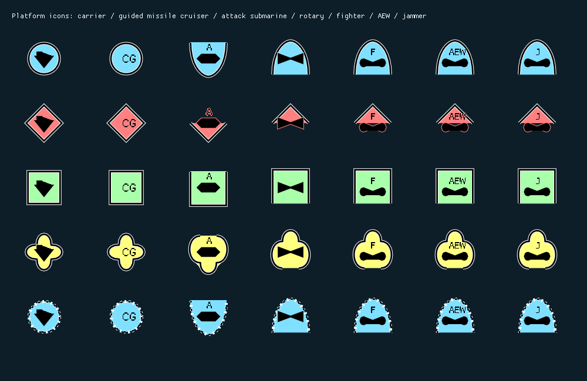

# Carrier, unknown frames and guided missile cruisers

16 October 2026. Follow-up to the primary-platform-role implementation.

## Changes

- Carrier geometry now has a tower 10 coordinate units high above a hull 25 units
  high, rather than a tower as tall as the hull. The closed silhouette is filled
  with the icon foreground colour. It remains filled in both display presets,
  independently of whether the affiliation frame has a fill.
- Unknown air and subsurface frames have elongated side lobes and larger mission
  sectors. Their contours are vertical mirrors. Surface frames retain four equal
  lobes. The closed surface path no longer repeats its first vertex before ImGui
  closes it; this removes the zero-length seam at the left/bottom junction.
- `Classification::Api::Role::GuidedMissile` is appended to the generic domain
  enum, preserving existing enum values. Codec validation and the managed role
  mirror accept the new value. Primary role membership in PlatformRoles remains
  mandatory; the adapter adds it to the full list when publishing a type.
- SeaPower.Client now maps native encyclopedia abbreviation CG or full type
  Missile Cruiser to GuidedMissile. It uses runtime metadata, not comments in
  platform_roles.ini. Existing AirDefence/SurfaceWarfare/ASW capabilities remain.
- The domain converter retains cruiser entity 120202 and carries GuidedMissile
  as APP-06(E)(1) common sector 1 modifier 133: SIDC digit 21 is 1 and digits 17–18
  are 33. The renderer uses the owner's requested compact CG lettering for that
  combination; an ordinary cruiser remains CC. The generic contract and renderer
  contain no Sea Power identifiers or abbreviation lookup table.

The owner explicitly authorized this additional domain role. It extends the
previous decision that guided capability would not be inferred from ship names.
Capability now has an explicit generic representation, with the engine-specific
interpretation confined to SeaPower.Client.

The [owner's visual reference](https://commons.wikimedia.org/wiki/File:Military_Symbology_Guide.svg)
informed the requested carrier proportions and larger open-domain lobes.
[APP-06(E)(1), Table 1-3 and Annex A.13](https://studylib.net/doc/28067209/app-06-ede-v1-e)
define the guided-missile common modifier and its digit placement. Table 5-2
supplies the cruiser entity. CG is the requested compact rendering of the
explicit cruiser/capability combination; CC is retained for the unmodified entity.

## Visual evidence

Generated by the actual renderer's regression fixture; synthetic symbols, not
a game screenshot. Columns: carrier, guided missile cruiser, attack submarine,
helicopter, fighter, AEW, jammer. Rows: friendly, hostile, neutral, unknown,
assumed friendly. The new unknown frames make room for the aircraft/submarine
mission text without enlarging the surface quatrefoil.

The earlier [primary-role gallery](PRIMARY_PLATFORM_ROLE_AND_ICON_CORRECTIONS.md)
is retained as historical evidence; this gallery supersedes its carrier and
unknown-frame shapes.

## Native evidence

Read-only inspection of Sea Power 8.3's installed English `vessel_names.ini`,
section `usn_cg_ticonderoga`, confirms `Type=CG,Missile Cruiser`.
`SimpleObjectParameters` encyclopedia loading assigns the first Type component
to `_typeAbbr` and the second, or first when absent, to `_typeFullName`.
Technique: installed configuration reading and previously recorded ILSpy
inspection of `Seapower-Scripts.dll`; statically verified. Assembly SHA-256:
`0FE6AAF2A6D9982E7E2EB41FD6035CB97C149773202C90821D71C00A9FDEB01A`.
The CG abbreviation also works when the full name is localized. Unsupported
designations remain unspecified. Live publication and game presentation have
not been checked in this follow-up.

## Validation

| Suite | Passed |
|---|---:|
| Domain.Api Debug | 66/66 |
| Gateway.Api Debug, including native/C# new-role conformance | 10/10 |
| Symbology.Nato.Api Debug | 28/28 |
| Symbology.Nato.ImGui Debug | 18/18 |
| TacticalDisplay Debug | 17/17 |
| TacticalDisplay Release | 17/17 |
| CommandCenter Debug integration | 2/2 |

Managed provider tests passed, including CG/full-name mapping, localized full-name
handling and ordinary-cruiser exclusion. Renderer tests cover mirrored open frame
bounds, added mission-sector space and the explicit common modifier. The gallery
was regenerated and visually inspected. Handwritten C++ changes were formatted
with the project clang-format configuration; generated/vendor code was untouched.

Production code owns role interpretation and geometry. New fixtures remain in
module test directories. Logs and generated binaries stay under the owning
module's ignored `o/` directory, with `carrier-guided-` log names. No game files
were changed and no deployment or game launch was performed.

CommandCenter Debug and the SeaPower.Mod Release runtime/harness packages rebuilt
successfully against the final dependency pin graph. All 30 package manifest
file checksums match. The package build retains six existing managed assembly
version warnings and reports zero errors.

## Revisions

| Repository | Commit |
|---|---|
| Domain.Api | `ad69500d744072d645803ded9ea93951fd051b4a` |
| Gateway.Api | `406e3f76f4b58a473ef21767d28bf92f65d725cf` |
| Symbology.Nato.Api | `7a597d975009d10b0f2d3710b9107b4db62d43c1` |
| Gateway.Grpc.Api | `3c0a2a682d6f7a595f7d31717707d12d9c2770ba` |
| Gateway.Grpc.Client | `714a80fb7d7d396a6aeb95fbf0163675a153b3d6` |
| Gateway.Grpc | `407ecb7c82692181a71a8189a8a19a53a98d2084` |
| World | `001849a40f1d7b332311f1bd6dc46c9c9d5d4941` |
| Symbology.Nato.ImGui | `80340f647fd585ebd531ff4737ae0fc5702eaa75` |
| TacticalDisplay | `02415f26d218f17d3d161e0d768406ee856860e0` |
| SeaPower.Client | `427ec424f07770ec20922240efcc465c639ee228` |
| SeaPower.Mod | `a0fef0735c8b1ef0d5907b361e29df65c9b14fb0` |
| CommandCenter | `441e733f1dde8733803f9ba2661f9bcb2b7a04ee` |
