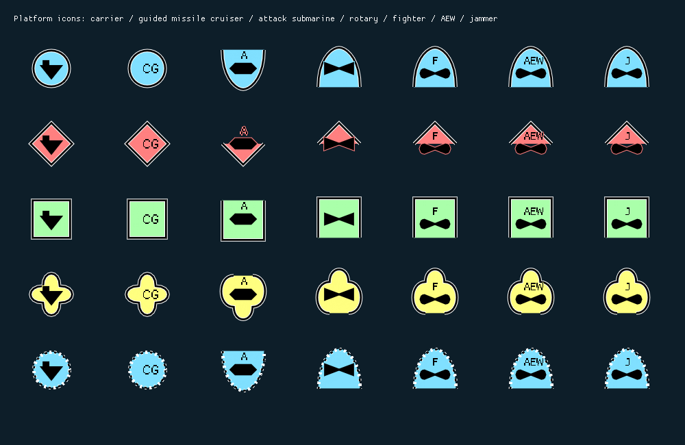

# Fill winding, stable layout and configurable primary roles

16 October 2026. Follow-up to live feedback on MajorCombat.

## Rendering corrections

Dear ImGui requires clockwise fill contours in screen coordinates, including for
the antialiasing fringe (`imgui.h`, filled-shape API comments). The carrier's
concave silhouette and the vertically mirrored subsurface frame had opposite
winding. The renderer now normalizes polygon fill winding before submitting it
to ImGui. This preserves the carrier's tower and hull and removes the incorrect
fill fringe at the unknown-subsurface lobe junctions. Stroke contours and measured
bounds remain shared with rendering.

The fixed-wing icon was a self-touching two-lobe path, which the concave
triangulator cannot treat as one simple polygon. It is now two independently
filled and stroked clockwise curved lobes. It no longer fills a closing bridge
beneath the centre junction.

Regression coverage checks actual rendered interior pixels for the carrier tower,
hull, space beside the tower, aircraft wing and empty space beneath its junction.
A separate renderer regression checks that opaque fill/fringe vertices for unknown
air and subsurface frames are vertical reflections, including the lobe joins.

This synthetic gallery supersedes the previous fill evidence. It uses the actual
renderer triangles and font atlas; it is not a game screenshot.

## Decluttering hysteresis

Small changes previously reran nearest-displacement minimization, which could
alternate between similar solutions on opposite sides of a contact group.

- Retain a clear previous placement unless displacement improves by at least
  8 pixels plus one quarter of the proposed relocation distance.
- Require 4 pixels of additional obstacle clearance for a voluntary relocation.
  Collision repairs also leave this clearance and weight movement away from the
  prior anchor, favouring nearby corrections over swapping sides.
- Preserve offsets during ordinary movement and small changing numeric-label
  widths. New arrivals do not automatically discard existing placements.
- Icon/scale changes, substantial label-bound changes, hover transitions and
  viewport changes still permit immediate reflow. Scale reduction and hover-label
  collapse regressions continue to pass. Selection alone remains layout-neutral.
- Search remains bounded; genuinely overconstrained scenes may still overlap or
  clip. Hysteresis does not guarantee a feasible arrangement for every viewport.

New deterministic regressions exercise 240 updates of a three-ship group with
small relative motion and 120 updates after a nearby aircraft appears. They
check separation and reject large alternating visual jumps. These are synthetic
motion fixtures, not a claim of live MajorCombat validation.

## Classification overrides

`platform-roles.ini` now supports `[PrimaryPlatformRoles]` as well as
`[PlatformRoles]`. Both use exact type IDs. A primary entry contains one role;
empty explicitly clears it and absent preserves native classification. A configured
primary role takes precedence over the native primary and is included in the
published capability list. Capability ordering does not determine runtime primary
role selection. Unit types and exactly identified observations share this path.

Bundled defaults:

| Platform | PlatformRoles | PrimaryPlatformRole |
|---|---|---|
| Udaloy | AntiSubmarineWarfare, SurfaceWarfare | AntiSubmarineWarfare |
| Kilo | AntiSubmarineWarfare, SurfaceWarfare | AntiSubmarineWarfare |

Read-only inspection of the installed Sea Power 8.3 content verifies Udaloy's
`AI.Role=ASW,ASuW` and encyclopedia `Type=BPK,Destroyer`; Kilo has `AI.Role=SS` and
`Type=SS,Patrol Submarine`. The prior native SS mapping deliberately supplied no
mission role. The ASW/surface-warfare submarine defaults and primary choices are
authored classification policy injected through the INI, not observed native
mission assignments.

The maintained generator materializes editable primary choices from principal
encyclopedia types, ship designations and an explicit default role policy. Its
priority table is independent of native capability-list order. It also fills the
previously empty submarine/carrier capability defaults. Variant fragments without
platform metadata are excluded. Regeneration overwrites custom edits, as documented
in SeaPower.Mod's README.

Catalogue audit: 558 type mappings, 470 nonempty capability lists and 470 explicit
primary-role entries. Every nonempty list contains its configured primary; no
non-civilian vessel entry has an empty capability list. The remaining 88 empty
entries cover objects without an applicable configured platform mission role,
including animals, civilian small craft and static scenery/installations. These
are not assigned invented military purposes. Custom/mod types still require
appropriate INI entries when their native metadata is incomplete.

Parser tests cover primary precedence data, explicit absence, missing keys and
invalid/numeric/multiple role values. A regression loads the actual bundled file,
checks Udaloy/Kilo and audits all role-bearing entries.

## Validation and delivery

| Suite | Result |
|---|---:|
| Symbology.Nato.ImGui Debug | 19/19 passed |
| TacticalDisplay Debug | 19/19 passed |
| TacticalDisplay Release | 19/19 passed |
| CommandCenter Debug integration | 2/2 passed |
| SeaPower.Client managed provider | Passed |
| SeaPower.Mod managed runtime/configuration | Passed |

CommandCenter Debug and SeaPower.Mod Release runtime/harness packages rebuilt
under the final dependency pins. All 30 package manifest checksums match.
The package build reports zero errors and retains six existing managed assembly
version warnings. No deployment, loader activation or game launch was performed.
Live rendering and moving-contact behaviour remain to be checked in Sea Power.

Logs: affected module `o/fill-hysteresis-*.log`; generated binaries, package stages
and temporary build data remain under module `o/`. Handwritten C++ changes use
the project clang-format configuration. Production owns geometry, layout and
configuration resolution; regression fixtures and the copied default INI used
by configuration tests remain in test targets and are excluded from runtime
packages. No proprietary source or binaries are committed.

## Revisions

| Repository | Commit |
|---|---|
| Symbology.Nato.ImGui | `762c965d2e9762b14310d76474852fd639a9a62e` |
| TacticalDisplay | `a621a37f9b4cd282493611156648aba076a07282` |
| SeaPower.Client | `ca28d2a8397ae4f811218c14668e8c4ecc7c52da` |
| SeaPower.Mod | `bb27c51f3e8ff4d813194f9f3ff8c2e09a6be6b2` |
| CommandCenter | `25ef351c081309da6acdf023cee7d509b8cabee4` |
