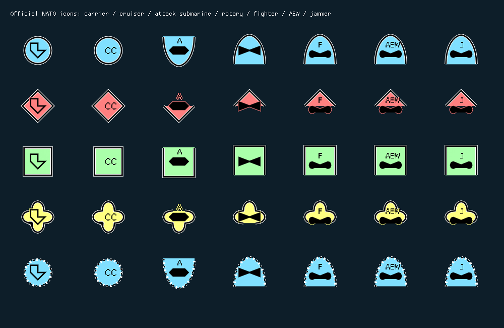

# Primary platform role and NATO icon corrections

Date: 16 October 2026. Owner-approved extension to Task 023.

Subsequent feedback is implemented in the
[carrier, frames and guided cruiser follow-up](CARRIER_FRAMES_AND_GUIDED_CRUISERS.md),
which supersedes the carrier/unknown-frame geometry and adds explicit GuidedMissile
classification and CG presentation.

## Decision

Add optional `Classification::Api::Role PrimaryPlatformRole` to
`Units::Api::Type`. It represents the platform's principal intrinsic mission.
Keep physical `SubCategory` and the complete `PlatformRoles` list. A present
primary role must occur in that list; an absent primary role is unspecified.
Do not infer priority from list order or the selected loadout.

This changes the domain freeze only for the explicitly requested role addition.
The owner also explicitly chose official NATO notation and engine independence.
Sea Power CG/CVN/SSN strings therefore do not become renderer inputs. Cruiser
uses NATO CC; carrier uses the carrier outline; submarine retains its applicable
role modifier. Nuclear propulsion and guided weapon capabilities are not inferred
from platform names.

Previously, the converter inferred Fighter from membership in a capability list
and ignored AEW/EW. That cannot distinguish a platform's principal mission from
secondary capabilities. Alternatives considered were list-order priority and
game-specific hull designation strings. Neither supplies a suitable generic
principal-role contract.

## Data flow and migration

- Domain.Api owns the optional role and documents its invariant.
- Gateway.Api carries `optional int32 primary_platform_role = 7` in canonical
  UnitType. C++ codecs preserve presence, including enum value zero, and reject
  invalid enums or a primary role absent from the capability list. C# bindings
  use the same schema and participate in round-trip conformance tests.
- SeaPower.Client translates the native encyclopedia principal type into the
  generic role. It adds that role to the exported capability list when necessary.
  Native AI capability roles remain the full list. Current loadout does not
  choose the primary role. Unsupported principal type strings remain unspecified.
- Symbology.Nato.Api's optional domain adapter selects supported aircraft mission
  modifiers from PrimaryPlatformRole: F, AEW, J, A, ASW, C, K, P and R. Missing
  primary roles remain generic. Exact identified observations use the same type
  conversion. The core renderer/converter remains usable without simulation
  primitives.
- TacticalDisplay exposes the primary role in type details for authoritative
  units and fully identified observations.
- All affected consumers and dependency pins were migrated together. No parallel
  legacy field, compatibility alias or game-specific generic API was introduced.

## Geometry and layout

- Selection no longer changes placement priority or invalidates the placement
  cache when measured geometry is unchanged. Hover pinning remains. A label mode
  that reveals labels upon selection can still change the occupied geometry and
  legitimately require layout.
- The submarine role letter is positioned using measured text height above the
  hull, with clearance.
- The carrier outline is intentionally closed. It is drawn as an outline so its
  internal shape remains legible. Cruiser maps to entity 120202 and displays CC.
- The helicopter uses two independently tessellated triangles, eliminating the
  central rectangular artifact from the self-intersecting polygon.
- Aircraft and helicopter geometry is enlarged. Aircraft mission text reserves
  a separate upper sector. Measurement and rendering share the geometry.

The synthetic gallery below is rasterized from the actual renderer's triangles
and font atlas by the reusable visual regression fixture. Columns are carrier,
cruiser, attack submarine, helicopter, fighter, AEW and jammer. Rows exercise
friendly, hostile, neutral, unknown and pending identities. It is not a game
screenshot.

## Evidence and limitations

NATO APP-06(E)(1), Table 5-2 lists carrier 120100 and cruiser 120202;
Table 2-4 lists air mission modifiers including fighter 4, AEW 12 and electronic
combat/jammer 16. Section 5.2.3 describes icon/modifier sectors and resizing for
readability. Reference: [NATO-authored document mirror](https://studylib.net/doc/28067209/app-06-ede-v1-e).
The public [milsymbol implementation](https://github.com/spatialillusions/milsymbol)
provided an additional geometry reference for the carrier outline and helicopter
triangles. It is not a production dependency and its checkout is ignored scratch
inspection material.

Read-only ILSpy inspection of Sea Power 8.3 `Seapower-Scripts.dll`,
`SimpleObjectParameters` and `ObjectBaseParameters`, verified `_typeAbbr` and
`_typeFullName` and the encyclopedia Type loading path. Installed English
`aircraft_names.ini` identifies `usn_e-2c` as AEW&C and `usn_ea-6b` as EW Aircraft.
These map to generic AirborneEarlyWarning and ElectronicWarfare respectively.
Assembly SHA-256:
`0FE6AAF2A6D9982E7E2EB41FD6035CB97C149773202C90821D71C00A9FDEB01A`.
Technique and confidence: statically verified metadata path; source mapping
covered by managed regressions. English native strings are supported by the
mapping table; unsupported/localized values leave the primary role unspecified.
Live publication and presentation in this installed game version remain unchecked.
No vendor binary or decompiled source is committed.

## Validation

Debug build and test results:

| Suite | Passed |
|---|---:|
| Domain.Api | 66/66 |
| Gateway.Api, including native/C# conformance | 10/10 |
| Symbology.Nato.Api | 27/27 |
| Symbology.Nato.ImGui | 16/16 |
| TacticalDisplay | 17/17 |
| CommandCenter | 2/2 |

TacticalDisplay Release also passed 17/17. SeaPower.Client's managed provider
suite passed, including primary-role mapping regressions. The final CommandCenter,
TacticalDisplay and renderer Debug rebuilds passed after the last text placement
adjustment. The gallery was regenerated and visually inspected.

SeaPower.Mod Release runtime and harness packages rebuilt under the final pin
graph. All 30 runtime/harness manifest file checksums match. Existing managed assembly-version warnings remain. Generated packages and
logs stay under module `o/` directories; package staging does not deploy or launch
the game. No live game validation was performed.

Logs: module `o/primary-role-build.log` and `o/primary-role-tests.log`,
TacticalDisplay `o/primary-role-release-{build,tests}.log`, and SeaPower.Mod
`o/primary-role-package-build.log`. Disposable native inspection and public
reference checkout remain under ignored `Docs/o/`; regression fixtures live in
module test directories, outside production packages.

## Revisions

| Repository | Commit |
|---|---|
| Domain.Api | `424c083e0fd67a245fbade244c4ecf5570481a2e` |
| Gateway.Api | `fe5ab9f1c30e275bcf98757a74609baa2f989694` |
| Symbology.Nato.Api | `c507e067a8f01a3f1c9985cadfb0405389900a71` |
| Gateway.Grpc.Api | `3b60b8cafd441d50ef7d333ee94004254a0b0ffc` |
| Gateway.Grpc.Client | `416536bb028408d4004b837181c32f66a5d72fab` |
| Gateway.Grpc | `981a1c33a7093f209695a3a0a1729c9223dc0e84` |
| World | `c64d2a7ac12d024ce38729fc4314f2a3dd44290a` |
| Symbology.Nato.ImGui | `3ca246c22925f9c64aed587aa8efcea4e866ce69` |
| TacticalDisplay | `4814533616cf6993ed181471ea9ecfd05490cbb4` |
| SeaPower.Client | `6b940819841a6ca6bfa4d769ac363021b561dba7` |
| SeaPower.Mod | `2fe74ea4eba8e83bd0b71ba8351e80b760a5e017` |
| CommandCenter | `c2d634437b72804d159ecdcef8e4206fca947fc9` |
