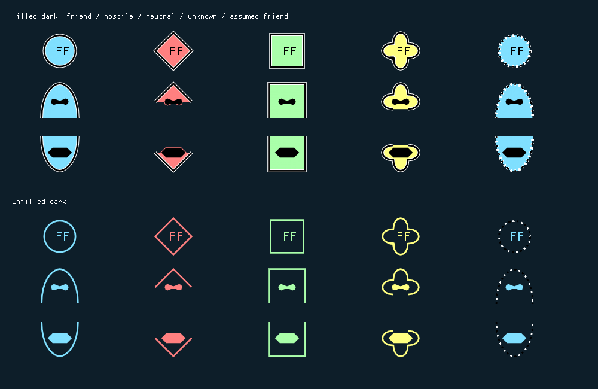
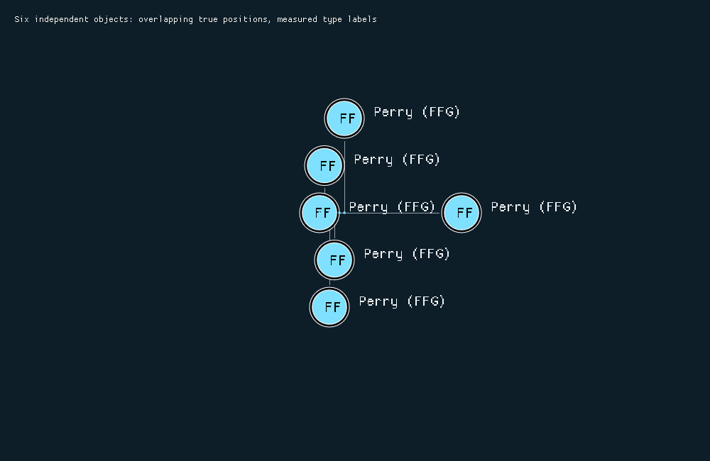

# Task 023 — Symbol styling and tactical map decluttering

## Scope and architecture

Implemented on `feature/classification`, continuing from the owner's pushed revisions.
Production changes belong to Symbology.Nato.Api, Symbology.Nato.ImGui,
TacticalDisplay and CommandCenter. New layout code is maintained production
presentation code; tests and CPU visual rasterization are regression fixtures.
No Domain, simulation, transport, observation or classification semantics changed.

The owner separately approved dependency-pin-only edits in Gateway.Api,
Gateway.Grpc.Api, Gateway.Grpc.Client, Gateway.Grpc and World. Their existing pins
referenced the older Domain type contract, and the shared resolver correctly
rejected a graph containing both revisions. Those five repositories contain only
CMake pin changes for this task.

The accepted dependency-injection decision is preserved: TacticalDisplay knows
`IRenderer`, never the concrete ImGui renderer. Scene-wide layout is exclusively
TacticalDisplay's responsibility. The pre-release API change intentionally removes
the single `Anchor` and renderer-owned hover-label switch; consumers migrate to
independent anchors and caller-resolved label visibility. No compatibility alias
or Domain concept was introduced.

## Styling contract and standard references

`Color` is byte RGBA; `AffiliationPalette::Resolve(StandardIdentity)` is shared by
renderer and exact-position dots. Pending/unknown, assumed/friend, suspect/hostile,
and neutral resolve to their respective palette groups without changing frame
identity or status semantics.

`SymbolStyle` is a per-context value. `StylePreset` supports FilledDark (default),
UnfilledDark, and FilledLight. The dark-map GUI offers the two dark presets;
FilledLight is available to other API consumers. Values allow palette, icon,
frame, text and halo colors, halo width and line-thickness factor to be adjusted.
Unfilled uses affiliation color for frame and icon; filled uses black by default.
Text defaults to a light foreground on the dark map. FilledLight uses dark text.

| Affiliation | Default fill |
|---|---|
| Friendly / assumed friendly | `#80E0FF` |
| Hostile / suspect | `#FF8080` |
| Neutral | `#AAFFAA` |
| Unknown / pending | `#FFFF80` |

Reviewed [APP-06 Edition E Version 1, §1.2.1](https://studylib.net/doc/28067209/app-06-ede-v1-e):
frame shape communicates identity/dimension; fill represents its interior and may
reinforce identity. Air/space frames remain open below and subsurface frames open
above. Uncertain identities retain alternating black/white patterns; planned
status retains dashes. Filled contours follow the existing frame samples, closing
only the fill polygon across the opening, never adding a closing frame stroke.
A narrow patterned frame halo preserves dash gaps. An affiliation-colored icon
halo helps black details that extend beyond an open contour. There is no
rectangular backing panel or replacement icon geometry. This is styling of the
existing supported subset, not a claim of complete APP-06 coverage.

Operational-condition bars and destroyed indication retain their existing
colors. Existing entity and role mapping is preserved. Corrected the ImGui
`PathStroke` argument order in existing curved icon paths while sharing them
between measurement and drawing.



The image uses real renderer triangles and the test's active ImGui font atlas.
It is a synthetic visual fixture, not a Sea Power screenshot. Rows show surface,
air and subsurface symbols; columns show friend, hostile, neutral, unknown and
assumed friend. Open contour fills and contrasting icon halos are visible.

## Measurement and anchors

`IRenderer::Measure(Symbol, RenderContext)` returns `MeasureResult` without an
ImDrawList, vertices, indices, clipping commands or invisible drawing. It needs
an active ImGui font context. The renderer traverses the same individual-symbol
geometry through a non-drawing sink. Rendering uses the drawing sink.

Results separate:

- `SymbolBounds`: frame and internal icon, including conservative ink padding;
  used for hover, click, selection and connector termination.
- `LayoutBounds`: movable frame, attached marks, status/context and visible text.
- `GeographicBounds`: fixed movement and uncertainty; degenerate at the true
  anchor when absent.
- `Bounds`: combined output, retained separately from collision bounds.

Text uses the actual active font's `CalcTextSizeA` at the requested size, including
multiline height. Row advancement includes the measured height and scaled gap.
Hidden labels contribute no reserved text area; type-only and rich labels use
the same geometry code during measurement and rendering.

`RenderContext::GeographicAnchor` is the actual projected unit/observation
location. `VisualAnchor` is the caller's displaced presentation position.
Headquarters staff, context marks, labels and selection follow presentation.
Speed leaders and direction arrows start at GeographicAnchor, including HQ
symbols. Geographic uncertainty is projected from its reported location.
Navigation routes still project the original Domain route coordinates.

`RenderLayer` allows geographic output to be drawn for the whole scene before
presentation output. Affiliation dots are drawn at exact screen coordinates after
icons so filled symbols cannot hide them. Displaced symbols have thin subdued
dashed connectors terminating at the first core bounding-rectangle boundary;
connectors are omitted when the dot is inside the core or the gap is negligible.
They have no arrowhead and differ from solid speed leaders and gray navigation.

## TacticalDisplay pipeline and stable layout

One acquired provider frame is retained throughout rendering. Symbols are collected
as values, keyed by `(Contact, Id)` so equal UnitId/ObservationId strings cannot
alias. Only geographically localized objects whose anchors lie in the viewport
enter the map layout; other objects remain in the existing tactical list.

1. Restore prior visual offsets using stable keys, adjusting for current projected
   geographic positions. Resolve hover against prior displayed core bounds.
2. Decide label visibility from selected/hovered state and the four existing
   frequency settings. Measure current style, scale and richness.
3. Place the hovered symbol first at its existing visual anchor, then selected
   symbols, then stable identity order. Include a four-pixel collision gap.
4. Try the geographic anchor (selected symbols prefer their previous anchor),
   then a valid prior placement. Otherwise search rectangle-edge separating
   translations in increasing distance order.
5. Render geographic geometry, connectors, displaced symbols, selection and
   true-position dots. Click hit testing uses final core bounds and selects one
   distinct key deterministically. Persist placements and evict vanished keys.

Candidate search is bounded to 192 examined placements per object, with a bounded
queue. It does not use radial clusters or aggregate markers. Objects at identical
coordinates receive deterministic separate visual placements and coincident dots.
Previous valid placements reduce jitter; free objects return to geographic
anchors when space permits. Panning preserves offsets away from edge constraints.

Hover ownership is determined before expanded text is measured. A hovered icon
is a fixed obstacle even when its own label richness changes; neighbors move.
Prior hover wins ambiguous overlap hits. Selected priority cannot move the hovered
icon. Labels and geographic dots are not hover targets. Perspective and explicit
World session identity invalidate state; viewport/projection, scale, style,
classification and label changes are handled by current measurements. No raw
World pointers are retained in layout state.

Repeated equivalent frames bypass collision search after comparing viewport,
hover, selection, geographic anchors and measured rectangles. Persistent map
entries are reused; disappeared objects are removed. Font measurements are
refreshed so current font and text changes cannot leave stale bounds.



The synthetic scene uses actual type-label measurements and independently keyed
objects near the same geographic position. Its visual fixture uses neutral
connectors; production connectors use the dashed style described above.

## Dense-layout limitations and performance

The bounded greedy search is not a global packing optimizer. A crowded scene can
retain overlap even when a more expensive global rearrangement might fit. If the
viewport or a long label cannot contain a feasible arrangement, the best examined
placement is retained and labels can clip. Hover stability takes precedence over
edge clamping for the fixed icon. Every identity is retained; the tactical list
remains available for selection. No object is hidden or replaced by a cluster.

The collision search has a fixed candidate budget and quadratic pair comparisons
for a scene of hundreds of objects. It performs no provider I/O. Synthetic
300-object coincident-anchor timing in Debug was about 199 ms for initial layout
and 13 ms total for 20 cached frames, including fixture measurement/state updates.
Release measured about 16 ms initially and 1 ms total for 20 cached frames.
This deliberately pathological initial layout
can produce a one-frame hitch; ordinary unchanged frames reuse the solution.

## Validation

Windows, MSVC 14.44 / Visual Studio 2022, Ninja and CMake 4.2; `/std:c++latest`,
`x64-windows-static`, `/MTd` Debug and `/MT` Release. This toolchain supports the
features used here; complete C++26 conformance is not claimed.

| Suite | Result |
|---|---|
| Symbology.Nato.Api Debug | 26/26 passed |
| Symbology.Nato.ImGui Debug | 16/16 passed |
| TacticalDisplay Debug | 12/12 passed, including local-provider window smoke |
| CommandCenter Debug | 2/2 passed, including mock gRPC/World/rendering/reconnect |
| Fresh pinned-Git CommandCenter Release | build passed; 2/2 tests passed |
| TacticalDisplay Release | build passed; 12/12 tests passed |

Coverage includes palette/presets, custom API colors, filled/unfilled and open
frames, uncertain/planned frames, status/destruction colors, unchanged SIDC/domain
mapping, measured-versus-rendered bounds, no measurement drawing effects, rich/
minimal/hidden/multiline labels at multiple scales, projected uncertainty and
movement under displacement, HQ direction origins, coincident mixed identities,
label-only collisions, viewport edges, pan/zoom, classification-size changes,
selection priority, final-core click targeting and repeated hover transitions.
The renderer/layout integration additionally measures real labels and holds a
hovered symbol fixed across twelve expansion frames.

Debug logs are under each repository's ignored `o/styling-build.log` and
`o/styling-tests.log`; CommandCenter uses its existing `o/wdb` cache and other
roots use `o/windows-msvc-debug`. Run each with:

```powershell
cmake --build <binary-directory> --parallel 8
ctest --test-dir <binary-directory> --output-on-failure --no-tests=error
```

Fresh Git validation cloned committed CommandCenter and resolved every dependency
by its pinned Git revision, with no Build.Local.cmake overrides. Process-local
Git URL rewrites pointed to the local repositories so unpublished commits could
be validated before pushing. No tracked resolver or global Git configuration
was changed. The clone, configure/build logs and test results remain under
`CommandCenter/o/git-validation/`. Existing third-party vcpkg binaries were reused;
this was a clean internal-source Release build, not a rebuild of vcpkg itself.

Visual fixtures write PPM files in the test working directory; the PNGs here are
lossless conversions. No vendor assets or game binaries were used. Tests require
no live Sea Power session. No live game launch, loader activation or game-folder
change was performed. Full Sea Power presentation acceptance remains a manual
follow-up on the owner's next scenario run.

The two symbology formatter configurations now match the existing shared style
subset and the original Allman/namespace indentation in their handwritten sources.
Modified handwritten source was formatted and inspected; namespace closing
comments were removed. No generated/vendor source was formatted.

## Recorded implementation revisions

All are on `feature/classification`. Docs is committed after this report records
the final code revisions.

| Repository | Commit |
|---|---|
| Symbology.Nato.Api | `0647729e46dd916bcac57148f2568ed339670faf` |
| Symbology.Nato.ImGui | `e257bd69ad91e1845115af35f17fdcec32696c0f` |
| TacticalDisplay | `d59b31a7298c210e208ceed38101acdaadd71488` |
| CommandCenter | `172c203dd015515b6291e8115c2b2203fa33f513` |
| Gateway.Api | `94cca460b5d44d7c4211a6e8f06a5af3be2b6fd2` |
| Gateway.Grpc.Api | `82216b583f82fc60d784cc9d1a62b3488a99a88e` |
| Gateway.Grpc.Client | `4960966e505be4aa9861180660e80e439b8c0c3f` |
| Gateway.Grpc | `291a296f4d3ee4df1d978038d110c5b3faad116a` |
| World | `66ec0b2e498a378af63f53a90d2d1ddfee63ddbc` |
