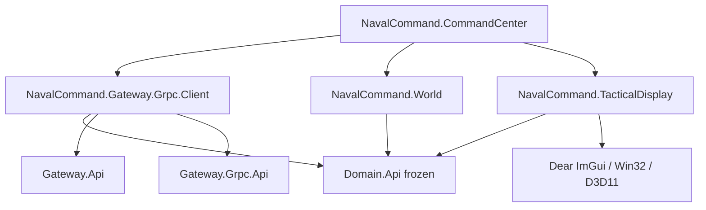
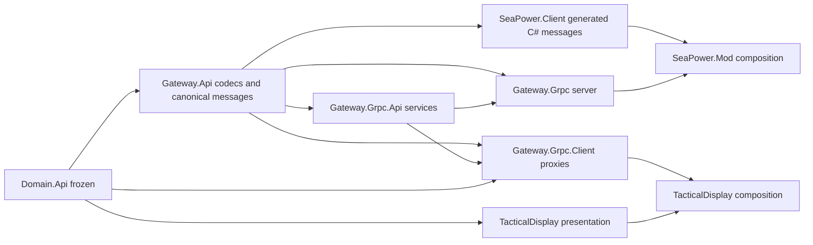
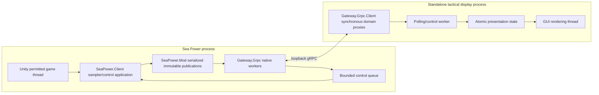

# Sea Power tactical display: architecture and feasibility

Historical Stage A review, 2026-10-12. Current implementation and acceptance status are in [IMPLEMENTATION.md](IMPLEMENTATION.md). This is a proposed implementation plan, not a report of completed integration. The owner's pasted assignment and revised client architecture take precedence over legacy architecture documents.

## Approved revision

The owner approved Dear ImGui, Win32 and Direct3D 11 and creation of four independent repositories: `Gateway.Grpc.Client`, `World`, `TacticalDisplay` and `CommandCenter` under NavalCommand. `TacticalDisplay` is a reusable library; `NavalCommand.CommandCenter` is the standalone executable and sole client composition root. The earlier direct proxy-to-GUI proposal below is superseded.

`CommandCenter` depends on exactly the three implementation libraries. `Gateway.Grpc.Client` implements remote domain proxies and owns transport/session metadata, not the replicated application model. `World` depends only on Domain.Api, accepts injected providers, polls on wall time, atomically publishes immutable retained views and exposes cached domain providers. `TacticalDisplay` depends only on Domain.Api and its approved GUI dependencies. All read-only providers supplied to the GUI in CommandCenter come from World. Perspective requests cross an injected application callback; the display never imports World or transport types. Controllers execute through a bounded application worker so GUI actions do not block rendering.

For coherent upstream reads, World accepts a transport-independent acquisition callback returning a retained bundle of existing domain interfaces plus session/revision metadata. CommandCenter binds this to remote revision acquisition; local sources can supply equivalent immutable bundles. No additional domain model or World dependency enters the gRPC client.

Disconnected clients immediately lose their own pause claim when the server detects disconnection. The adapter reconciles effective pause on the validated game thread, preserving player and other connected-client claims. Reconnection creates fresh client ownership; old claims are never restored. Mission/session invalidation discards old-session requests and ownership. Detection of half-open network connections must be bounded and documented; transport loss is not observable instantaneously. No lease policy is introduced.

Implementation order: protocol and remote proxies with mock host; independent World replication and tests; CommandCenter composition; TacticalDisplay library; verified native adapter/control migration; authorized live validation. Native pause interception, faction information paths and relevant job fences remain investigation gates, but do not block independent mock-backed client work.

## Frozen contract and baseline

`Domain.Api` is at `f45d0e68c6dfbe122a58cffa61b37ffe2c9cdeb9`; its initial `git status --porcelain=v1` was empty. All eight existing Git repositories were initially clean. No domain changes are proposed. Existing gateway codecs reference removed `World::Api` and older order/observation structures; existing implementation targets also use obsolete domain target names. Migrate consumers and schemas together rather than repairing the frozen contract.

The current domain supplies authoritative `Units::Api::Instance` with faction membership, distinct `Observations::Api::Instance`, faction alignment, unit operations, simulation time, pause control and compression control. `Exact<T>` and `Resolution<Ts...>` remain the domain authorities. Operations queries take authoritative own-unit IDs; faction views must deny enemy operations lookups. No domain API currently supplies observed-contact operations, so V1 can show operations for authorized units only.

## Repository impact and dependencies

| Repository | Planned impact |
|---|---|
| Domain.Api | No edits, generation, configuration repairs or commits. Consume the reviewed contract. |
| Gateway.Api | Replace obsolete canonical schemas and codecs; generate C++/C# from identical inputs. Define immutable provider publications and queued control messages here. |
| Gateway.Grpc.Api | Replace services and transport envelopes; import canonical payloads. |
| Gateway.Grpc | Serve immutable provider publications, enforce scope on every request and deliver queued controls with application results. Rewrite mock infrastructure for the new protocol. |
| Gateway.Grpc.Client | Proposed separate repository; implement the original domain providers/controllers. Await repository approval. |
| SeaPower.Client | Replace selected-player-only publication with verified authoritative and native faction observation sampling; implement validated game-thread controls. |
| SeaPower.Mod | Compose the adapter/server, retain serialized-byte bridge, worker ownership, lifecycle and separate production/harness packaging. |
| TacticalDisplay | Proposed separate C++ application repository; framework and repository approval required. |
| Build.CMake | Reuse source resolution, presets and managed helpers. Change only where migration demonstrates a shared requirement. |
| Docs | Keep the plan here; update normative architecture/build documentation to the implemented result when migration is complete. |

Arrows show dependency input to consumer. Presentation accepts domain interfaces; only application composition constructs the connection/factory. Public client construction and status interfaces expose no channel, generated message or wire type. The server and mod do not depend on the GUI.

## Process and thread boundaries

Retain the existing completed-job and paused-Update scheduling concept. Inspect every newly sampled collection and its associated jobs before selecting a sampling boundary; current completion flags do not certify global sensor/ECS coherence. Publish a complete logical revision only after validating the relevant boundary. If that cannot be established, ask rather than claiming coherence. Network operations and acknowledgements never block the game thread. Domain controllers wait on the caller's worker with a bounded RPC deadline; success means the game-thread application succeeded, not merely queue acceptance. Expired or old-session commands must not later apply unnoticed.

## Canonical payloads and RPCs

Replace the old schemas rather than maintaining backward compatibility. Encode IDs distinctly; authoritative and observed kinematics separately; optional values with presence; `Resolution` and position alternatives with `oneof`; resource integer/continuous alternatives separately; and the actual equipment, type, operations and simulation structures. Preserve known zero/false, empty and unknown. Do not fabricate measurement timestamps or contact attribution.

Transport envelopes carry protocol version, session identity, revision, capture time, scope handle and request identity. Proposed operations: open scope, fetch scoped revision, apply pause request, apply compression request and close scope. Scope handles bind either a real faction or explicit privileged omniscient mode, never an `All` faction. Canonical provider publications may hold multiple immutable views privately; only the requested authorized view is serialized in an RPC response.

A revision contains provider data and explicit availability/error results. Error envelopes preserve infrastructure classifications and domain error alternatives. Stable error-code category/value codecs need an explicit registry for any transported `std::error_code` causes; arbitrary process-local categories cannot be reconstructed by guessing. Unavailable providers return errors, not empty collections.

Client scopes own session-scoped atomic caches. A worker refreshes one revision and builds presentation state from that revision. Connection loss marks the last picture stale, while current provider calls report unavailable/communication failures. Session or perspective changes invalidate identities, selection and caches; pending controls are never replayed automatically. Deadlines bound all RPCs and shutdown.

## Faction and simulator feasibility

The current production facade reads only `Globals._playerTaskforce`; it cannot already satisfy arbitrary faction views or omniscient truth. It also has old fixed collection limits that must be replaced with explicit bounds/errors or batching.

Existing static findings show each taskforce constructs a plotting table, and AI reads genuine table data. Historical bounded live fixtures reported contact estimates from both tables. This supports further investigation, not blanket verification of arbitrary faction views. See [static findings](../001/SEAPOWER_FINDINGS.md) and [runtime findings](../002/SEAPOWER_RUNTIME_FINDINGS.md).

Resolve actual faction identities and taskforce relationships from the engine; do not equate player-relative `TfType` labels with universal faction identity, or union tables without verified sharing semantics. Own truth comes from actual membership; foreign observations come exclusively from the selected native information path. Observation handles remain independent of true IDs and disappear when their source records disappear. Authoritative registry/type/equipment sampling must be verified separately. If any required field cannot be represented honestly, stop and ask.

## Pause and compression

Proposed pause arbitration records player intent at verified native control entry points and maintains a separate claim per external client. Effective pause is the union of those intents. Adapter-originated native changes need a reentrancy distinction so they do not become player intent. Player unpause must release only player intent while retaining active client claims. Menus, briefing/loading, direct compression setters and mission teardown require investigation before choosing interception coverage.

Existing findings show native `Pause`/`UnPause`, compression setters and no native owner token. Historical repeated-Pause tests are insufficient to prove complete player intent interception. Do not infer player intent from effective `IsPaused`. This is a real implementation gate, not permission to approximate arbitration.

Disconnect policy remains an owner decision:

| Policy | Consequence |
|---|---|
| Immediate release | A lost client can unpause a scenario when no other claim exists. |
| Retain until explicit release/reconnect | Avoids an unexpected unpause; requires recovery for a crashed/abandoned client. |
| Renewable lease | Bounds an orphaned pause; expiration can unpause without an explicit user release. |

Superseded by the owner's decision: immediately release a disconnected client's own claim, retaining native player and other clients' claims. Reconnection establishes fresh ownership.

Compression requests apply once in deterministic game-thread order; last successful application wins. Polling only reads state. Discover the actual supported factors and positive-compression side effects from the installed build; historical evidence of a 200x maximum is not a substitute for current capability discovery. Return `InvalidTimeCompression` for unsupported factors.

## GUI framework decision

| Candidate | Assessment for V1 |
|---|---|
| Dear ImGui + Win32 + Direct3D 11 | Recommended: compact dependencies, upstream Windows/rendering backends, immediate dynamic controls and custom tactical drawing. MIT license. Native accessibility and advanced text shaping are limitations. |
| Qt | Rich desktop facilities and presentation tools; broader dependency/deployment surface. Module licenses and static-link distribution obligations require a deliberate choice. |
| wxWidgets | Native desktop controls with a binary-distribution license exception; tactical rendering and scene interaction require more custom implementation. |

Primary sources reviewed: [Dear ImGui](https://github.com/ocornut/imgui), [license](https://github.com/ocornut/imgui/blob/master/LICENSE.txt), [Qt licensing](https://doc.qt.io/qt-6/licensing.html), [Qt obligations](https://www.qt.io/development/open-source-lgpl-obligations), [wxWidgets overview](https://wxwidgets.org/about/), [wxWidgets license](https://wxwidgets.org/about/licence/). Assessment and recommendation are engineering judgments. Await approval before adding a GUI dependency.

## Decisions and implementation gates

1. Resolved: Dear ImGui with Win32/Direct3D 11 approved.
2. Resolved: creation of the four revised client repositories authorized.
3. Resolved: immediately release disconnected-client ownership; reconnect with fresh ownership alongside the native player.
4. Validate native faction information paths, full pause intent coverage and coherent sampling before implementing those real-game features. No proven contract insufficiency has been identified in this review.
5. Live validation requires separate explicit authorization to deploy/activate the mod or change launch configuration. Nothing has been installed or launched in this review.

Stage B can proceed after module repository decisions with canonical codecs, scoped server/client and controlled mocks. Stage C depends on verified native behavior; Stage D depends on GUI approval. Keep those gates explicit and preserve independent completed work.

## Validation plan and current results

Planned native GoogleTest/GoogleMock coverage: proxy errors/timeouts, strict scope isolation including lookup/error paths, distinct observation IDs, optional/partial values, session/revision invalidation, reconnection, concurrent queues, pause truth table and multiple clients, compression application order, and clean shutdown. Generate C++ and C# golden payloads from one schema and exchange them in both directions. Mock-backed GUI validation must cover multiple units/contacts, perspective changes and simulation controls with a wall-clock refresh while paused.

Manual live scenario: two real factions with visible and hidden opponents; verify each native plotting picture against its external faction view, omniscient truth separately, every player/client pause combination, actual menu/control paths, player/client compression ordering, disconnect policy, mission reload and game exit. Record build/assembly hashes and avoid claiming mocks prove native behavior. The historical Debug gateway teardown crash remains unresolved and must be retested.

Actual results for this stage: repository status and domain revision checks succeeded; headers, schemas, provider/runtime boundaries and historical evidence were reviewed; GUI options were researched. No implementation builds, tests or live-game runs were performed. The selected shell's default CMake is not evidence of the required CMake 4.2+/VS 2026 environment; select and verify that environment for implementation builds.
